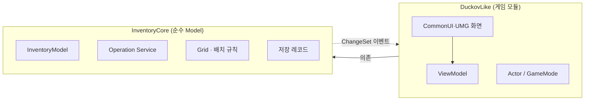

# Duckov_Like

**인벤토리 UI 하나를 데이터 소유권부터 Tick, 입력 수명까지 끝까지 파고든 프로젝트**

싱글플레이 탑다운 익스트랙션 슈터 형태의 CommonUI·UMG · 그리드 인벤토리 포트폴리오

`UE 5.7` · `C++` · `CommonUI` · `UMG` · `MVVM (FieldNotify)` · `Automation Test` · `Windows` · `GAS: 플러그인만 활성, 미구현`

> ### 🤖 이 프로젝트는 AI를 활용한 프로젝트입니다.
>
> **AI를 활용해 개발합니다.** 사용자는 목표·범위와 결과 수용을 맡고,
> AI는 기능 단위로 설계·구현·검증을 수행합니다.
> AI가 내린 기술 판단과 사용자가 실제 검토·수정한 내용을 구분해 기록합니다.
> 각 설계결정기록(ADR) 머리의 `판단 주체`·`사용자 검토` 칸에서 결정마다 확인할 수 있습니다.
>
> → [**AI 활용 방식**](#ai-활용-방식) · [작업 분담 규약](CLAUDE.md) · [작업 기록](docs/worklog/)

---

## 이 프로젝트가 증명하려는 것

상용 게임의 완성이 아니라 **시스템 하나를 제대로 설계하고, 설계대로 동작함을 검증 가능한
형태로 만들 수 있는가**를 보인다.

> 아이템 배치 규칙을 Model에 집중하고, ViewModel과 CommonUI·UMG 화면으로 표현한 그리드 인벤토리를
> 실제 루팅–탈출 루프에 연결한다.

기술 증명 축은 **①CommonUI·UMG 사용자 경험 ②MVVM과 검증 가능한 인벤토리 Model ③GAS** 순이다.
①②는 구현돼 있다 — CommonUI는 인벤토리·커스터마이징·타이틀 화면에 쓰이고, Model은 Automation Test로 검증한다.
③GAS는 `.uproject`에 플러그인만 활성화돼 있고 게임 모듈 의존과 구현은 없다. 리소스가 부족하면 ③부터 줄인다.
레퍼런스는 *Escape From Duckov*(Team Soda)이며 **분석 대상이지 클론 대상이 아니다.**

---

## 하이라이트

### 1. 실패하면 아무것도 바뀌지 않는 인벤토리 Model

- 이동·병합·정렬 같은 연산은 상태 없는 정적 조정자 `FInventoryOperations`가 관련 Container 전체를 먼저 검증하고
  한 번에 커밋한다. 실패하면 양쪽 Container, 점유 cache, ID 발급기가 그대로다.
  "Container끼리 서로를 알고 처리하는 것보다 별도 조정자가 둘을 동시에 다루는 편이 낫다"고 판단했다([설계결정기록 004](docs/architecture/004-operation-service-atomicity.md)).
- 아이템 Instance는 `UObject`가 아니라 `USTRUCT` 값 타입이다. 인벤토리의 모든 Instance가 GC 추적 대상이 되는 비용을 피했고,
  값 복사라서 별도 롤백 경로 없이 원자성이 나온다([설계결정기록 010](docs/architecture/010-item-instance-representation.md)).
- 실패는 `bool`이 아니라 `EInventoryOperationFailure`로 돌려준다. 병합 실패를 `StackMismatch`(다른 종류)와 `StackFull`(가득 참)로 나눠,
  UI가 이유를 구분해 보여줄 수 있게 했다([설계결정기록 012](docs/architecture/012-stack-merge-operation-contract.md)).
- 2026-10-15 기록 기준 Model Automation Test **69개**(`Duckov.InventoryCore.*`), 전체 **111개** 실패 0.
  → [M1a 작업 기록](docs/worklog/M1a.md) · [M3 작업 기록](docs/worklog/M3.md)

### 2. 이벤트 기반 UI — 아이템 100개에서 실측하고 고친 것

화면은 `Model → ChangeSet → ViewModel(FieldNotify) → Widget` 순서의 변경 통지로만 갱신한다
([설계결정기록 015](docs/architecture/015-inventory-viewmodel-flow.md)). 20×20 스태시에 아이템 100개를 넣고 실제 PIE에서 계측했다(2026-09-28, [M2 작업 기록](docs/worklog/M2.md)).

| 발견한 문제 | 조치 | 전 → 후 |
| --- | --- | --- |
| 같은 컨테이너 안 이동이 `RemoveAt` 후 `Add`로 배열 순서를 바꿔 Item 위젯 100개를 지우고 다시 만듦 | "같은 컨테이너 안의 위치·회전 변경은 순서를 바꾸지 않는다"는 계약으로 정하고(사용자 결정) 기존 slot을 갱신 | 위젯 생성/제거 100/100 → 0/0, median 11.183 → 0.120 ms |
| 위젯이 FieldNotify 3개를 따로 구독해 한 번 바뀔 때 `Refresh()` 3회 | ViewModel이 통지 끝에 native event를 한 번 보내고 위젯은 그것만 구독 | Refresh 3 → 1회 |
| 화면이 가만히 있어도 Screen·Grid·Item 위젯의 `NativeTick`이 300 frame 동안 위젯마다 300회 호출 | native 부모 클래스에 `meta=(DisableNativeTick)`. Tick 빈도는 `Auto`로 유지(`Never`는 animation·latent action의 일시적 Tick까지 막음) | Tick이 돈 위젯 103 → 0개 |

- 측정 범위는 Editor PIE의 인벤토리 위젯 계층과 한 대의 개발 PC다. 엔진·CommonUI 전역 Tick, packaged 빌드, 다른 기기는 측정하지 않았다.
  Tick 0 검사는 2026-10-15 전체 회귀에서도 통과했다. 이 성능 후속 작업들의 사용자 결과 검토는 아직이다.
- **남은 한계**: Sort는 여전히 Item 위젯 100개를 전부 다시 만든다(2026-09-28 기록의 median 13.576 ms). 최적화하지 않았다.

### 3. CommonUI 입력 수명 — 메뉴를 닫은 뒤 입력을 어디서 돌려주는가

- **Back 처리와 입력 복귀(2026-09-25)**: drag 중의 Back은 drag만 취소하고, 그 밖의 Back은 화면을 닫는다.
  닫은 다음 tick에 Game 입력과 viewport focus를 돌려준다. 사용자가 키보드·마우스로 수동 PIE를 확인하고 수용했다.
  게임패드는 장치가 없어 not_run, packaged 빌드도 not_run이다([M2 작업 기록](docs/worklog/M2.md)).
- **화면이 늘어날 때의 구조(2026-10-11)**: viewport에 root layout 하나를 붙이고 메뉴는 Menu stack으로 연다.
  처음 시도한 Lyra식 "항상 활성인 HUD가 Game 입력을 갖는" 구조는 실제 PIE에서 메뉴를 연 다음 프레임에
  Router가 HUD를 다시 active root로 골라 Game 입력으로 돌아갔고, lifecycle 테스트 2개가 실패해 폐기했다.
  재현 여부가 활성화와 첫 paint의 순서에 달려 있었고, 정확한 원인은 확정하지 못했다.
- 대신 **Menu stack이 비는 순간 한 곳**에서 입력을 복구한다. 폐기한 설계의 실패 지점(연 뒤 10 frame 동안 Menu 입력 유지)은
  `Duckov.UI.LayerStack` 회귀 테스트로 남겼다. 판단 주체와 검토 상태는 [설계결정기록 021](docs/architecture/021-commonui-layer-stack.md)에 있다.
- 이 구조 위에서 만든 HUD·인벤토리·커스터마이징 화면은 2026-10-15 사용자가 PIE로 확인했다. 설계결정기록 021 자체의 사용자 검토는 아직이다.
  → 구조 그림: [CommonUI 적용 구조](docs/COMMONUI_STRUCTURE.md)

---

## 핵심 설계: 모듈 경계를 빌드 시스템으로 강제한다

`View → ViewModel → Model` 단방향 의존은 흔한 원칙이다. 문제는 **단일 모듈에서는 지켰는지
확인할 방법이 없다**는 것이다. Model 코드가 위젯을 직접 조작해도 빌드는 통과한다.

그래서 게임 코드를 두 모듈로 나누고 의존을 `Build.cs`에 고정했다.

아래 그림과 책임 표는 현재 구현 기준이다. ViewModel·CommonUI 화면·ChangeSet 이벤트·저장 레코드는 구현돼 있고,
GAS 게임 로직은 아직 없다. 저장 레코드는 Model 계층까지이며 디스크 저장과 슬롯은 구현하지 않았다.
검증용 `InventoryCoreTests`는 두 Runtime 모듈과 별도의 Editor 모듈이다.



| 모듈 | 책임 | 의존 |
| --- | --- | --- |
| **`InventoryCore`** | 그리드, 배치 규칙, 연산 서비스, 변경 통지(ChangeSet), 저장 레코드 | `Core`, `CoreUObject`, `Engine` |
| **`DuckovLike`** | ViewModel, CommonUI 화면·위젯, 캐릭터·상호작용 액터, 타이틀·베이스먼트·레이드 흐름, 커스터마이징 | 위 + `InputCore`, `EnhancedInput`, `InventoryCore`, `UMG`, `ModelViewViewModel`, `CommonUI` (Private: `Slate`, `SlateCore`, `CommonInput`) |
| **`InventoryCoreTests`** (Editor) | `InventoryCore` Public 계약의 Automation Test | `Core`, `CoreUObject`, `Engine`, `InventoryCore` |

두 `Build.cs`를 나란히 놓으면 경계가 읽힌다 — 한쪽에는 UI 모듈이 있고, 한쪽에는 없다.
ViewModel·UI 테스트는 `DuckovLike` 모듈 안에 두어 Model 테스트 모듈에 UI 의존이 들어가지 않게 했다.

### 경계가 실제로 작동하는 지점 (실측)

M0.5에서 `InventoryCore`의 UMG 사용을 3단계로 측정한 기록이다.
이번 문서 변경에서는 재실행하지 않았다([당시 작업 기록](docs/worklog/M0.5-scaffolding.md)).

| 시도 | 결과 |
| --- | --- |
| `#include "Blueprint/UserWidget.h"` | 통과 |
| `UUserWidget* Ptr = nullptr;` | 통과 |
| `UUserWidget::StaticClass()` | **`LNK2019` → 빌드 실패** |

```
error LNK2019: unresolved external symbol Z_Construct_UClass_UUserWidget_NoRegister
fatal error LNK1120: 1 unresolved externals
Result: Failed
```

헤더가 통과하는 이유는 에디터 타깃의 `SharedPCH.UnrealEd`가 UMG 헤더를 이미 담고 있기
때문이다. 경계를 만드는 것은 include path가 아니라 **`UMG.lib`가 링크 라인에 없다는 사실**이다.

즉 경계는 즉각적이지 않지만 **우회 불가능하다.** UI 타입의 이름을 적어 둘 수는 있어도,
그것을 실제로 사용하는 코드는 한 줄도 빌드를 통과하지 못한다.

→ 결정 근거와 기각한 대안: [설계결정기록 000](docs/architecture/000-module-boundaries.md) (문서 상태: Proposed)

---

## 설계 원칙

| 원칙 | 내용 |
| --- | --- |
| **Single source of truth** | 위치·회전·수량은 Model만 소유한다. ViewModel은 ID로 Model을 매번 조회하며 원본 상태의 사본을 갖지 않는다 |
| **원자성** | 컨테이너 간 이동, 정렬, 저장 복원, 레이드 탈출의 일괄 이전은 전체 검증 뒤 한 번에 커밋한다. 실패 시 상태가 변하지 않는다 |
| **명시적 실패** | `bool`이 아니라 실패 사유를 반환한다 — `NoSpace`, `Occupied`, `StackMismatch`, `StackFull`, `InvalidCategory` … |
| **안정적 식별자** | 아이템 Instance는 전역 순차 카운터가 발급하는 `int32` 번호로 저장과 ViewModel 매핑을 지원한다 |
| **이벤트 기반 UI** | 인벤토리 화면은 상시 Tick에 의존하지 않는다 — 측정 결과는 [하이라이트 2](#2-이벤트-기반-ui--아이템-100개에서-실측하고-고친-것) |

불변식 8개(`INV-01`~`INV-08`)와 연산 계약은 [인벤토리 설계 문서](docs/INVENTORY_DESIGN.md)에 있다.

---

## 진행 상황

| 단계 | 내용 | 상태 |
| --- | --- | --- |
| M0 | 설계 — 데이터 소유권, 불변식, 연산 계약, MVVM 흐름 | 초기 문서 작성됨 · ADR별 상태 확인 |
| M0.5 | UE 프로젝트 스캐폴딩, 모듈 분리 | ✅ 완료 |
| M1a | Model 핵심 — 배치·이동·스택 | 기술적 완료(테스트 24개) · 사용자 검토 미확인 |
| M1b | Model 파생 — 정렬·저장·리사이즈 | Model 범위 완료 · 저장 레코드는 사용자 수용 · 디스크 저장·슬롯은 미구현 |
| M2 | ViewModel + CommonUI·UMG | ✅ 완료 — 화면·드래그·입력 lifecycle, 2026-09-25 사용자 수동 PIE 수용 · 성능 후속 3건은 사용자 검토 미확인 · 게임패드·packaged는 not_run |
| **M3** | **게임 루프 — 루팅·장비·탈출·스태시, GAS** | **진행 중** — 아래 |
| M4 | 성능 점검, 문서·영상 정리 | |

M3에서 구현된 것(2026-10-15 기록 기준):

- 월드 loot 획득, 스택 분할(Shift+클릭), 가방 교체, 최소 Raid 탈출
- 타이틀 → 커스터마이징 → 베이스먼트 흐름, 베이스먼트 지상 캐릭터, 창고·출격 지점·탈출 지점으로 도는 베이스먼트 ↔ 레이드 루프
- 원작 배치를 따른 HUD·인벤토리·커스터마이징 화면 개편, 드롭·줍기·전부 보관의 같은 종류 스택 병합

사용자 PIE 확인 기록이 있는 것은 loot 획득, 최소 Raid 탈출, 가방 교체, 커스터마이징, 화면 개편과 스택 병합이다.
타이틀 흐름·지상 캐릭터·베이스먼트 ↔ 레이드 루프는 사용자 검토 전이다. 가방 외 장비와 GAS는 착수하지 않았다.
범위 변경: 퀵 이동은 빼고 스택 분할로 대체했다(2026-09-29 사용자 결정).

**v1 완료 기준**과 현재 기록:

| 기준 | 기록 |
| --- | --- |
| Model Automation Test 30개 이상 통과 | 69개 통과(2026-10-15) |
| 20x20 스태시 + 아이템 100개에서 상시 Tick 위젯 0 | 인벤토리 위젯 계층에서 0으로 측정(2026-09-28, 2026-10-15 회귀 통과) · 사용자 결과 검토 미확인 |

---

## AI 활용 방식

2026-09-10부터 **기능 단위 자율 실행과 결과 검토**를 기본으로 한다.

| 사람이 하는 것 | AI가 하는 것 |
| --- | --- |
| 목표·범위·완료 기준 제시 | 권장 설계와 핵심 trade-off 설명 |
| 계약을 깨는 변경·범위 확대 판단 | 범위 안의 header·specifier·구현·테스트 작성 |
| 동작과 핵심 구조 검토, 결과 수용 | 빌드·검증, 책임과 데이터 흐름 설명 |
| 필요할 때 학습·수정 요청 | 필요한 ADR와 worklog를 기능 단위로 정리 |

문서마다 사용자 선답변을 받거나 테스트 이름을 직접 쓰게 하지 않는다.
AI가 핵심 선택·근거·대안과 검증 결과를 함께 제출해 사용자가 결과를 판단할 수 있게 한다.
기존 계약을 깨는 변경은 먼저 확인하며, commit·push는 별도 명시 권한이 필요하다.

설명 역전·퀴즈·Option Sweep·walkthrough는 학습을 요청할 때만 사용한다. 구현·검증 완료와 사용자 이해·검토 상태는
분리해 기록한다. 과거 ADR와 worklog는 당시 방식의 기록으로 보존하되, 옛 학습·승인 절차보다
현재 작업 분담 규칙이 우선한다.

판단 주체는 시기에 따라 다르다. M1a까지의 Model 결정(설계결정기록 001·003·004·009~012)은 AI가 선택지를 나열하고
사용자가 최종 결정했다. 이후의 결정 대부분은 AI가 위임 범위 안에서 내렸고, 사용자가 결정한 부분과 사용자 검토 여부를 각 기록에 적었다.

### 기록

주장으로 끝내지 않기 위해 분담 내역을 저장소에 남긴다.

- [**작업 분담 규약**](CLAUDE.md) — 세션마다 자동 적용되는 규칙 (5절)
- [**작업 기록**](docs/worklog/) — 기능 완료 시 해당 마일스톤에 변경·검증·판단 출처를 한 번 요약.
  과거의 **내가 결정한 것 / AI가 수행한 것 / 내가 반려·수정한 것** 기록도 보존
- [**설계결정기록**](docs/architecture/) — 결정·근거·기각한 대안·판단 주체·사용자 검토 상태

> **예시** — `설계결정기록 000` 초안에서 AI는 모듈 경계 위반이 *"컴파일 에러로 막힌다"*고 썼다.
> 실측해 보니 컴파일과 타입 선언은 통과하고 **링크에서 `LNK2019`로 깨졌다.**
> 문서를 측정값으로 교정했고, 그 경위를 작업 기록에 남겼다.
> AI 출력을 검증 없이 받지 않는다는 것을 보이는 자리다.

---

## 문서

| 문서 | 내용 |
| --- | --- |
| [GDD](docs/GDD.md) | 목표·성공 기준·범위(P0/P1/P2)·기술 방침·검증 계획 |
| [인벤토리 설계](docs/INVENTORY_DESIGN.md) | 불변식, 제안 아키텍처(A1~E3), 연산 계약, MVVM 데이터 흐름 |
| [CommonUI 적용 구조](docs/COMMONUI_STRUCTURE.md) | root layout·Menu stack·layer 구성과 구조 변경 전후 |
| [원작 UI 관찰 기록](docs/DUCKOV_UI_REFERENCE.md) | 레퍼런스 화면 구성 관찰(텍스트 기록) |
| [커스터마이징 계획](docs/CUSTOMIZATION_PLAN.md) | 캐릭터 커스터마이징 prototype의 계약과 구현 기록 |
| [컨벤션](docs/CONVENTIONS.md) | 모듈 경계, 네이밍, Content 폴더 규약 |
| [설계결정기록](docs/architecture/) | 구조 결정 기록 — 결정·근거·기각한 대안·검증 |
| [작업 기록](docs/worklog/) | 마일스톤별 작업 내역, AI 활용 내역, 막혔던 것 |

초기 설계 문서의 제안과 이후 Accepted ADR를 구분한다. 상태는 각 ADR에서 확인하며,
새 결정에는 [현재 작업 분담 규약](CLAUDE.md)의 권한과 기록 방식을 적용한다.
과거 ADR를 일괄 재승인하거나 사용자 판단의 출처를 소급 변경하지 않는다.

---

## 빌드

**요구사항**: UE 5.7 · Visual Studio 2022 (C++ 데스크톱 개발) · Git LFS

```bash
git clone https://github.com/Jangjinhyeok/Duckov_Like.git
cd Duckov_Like
git lfs install
```

프로젝트 루트에서 PowerShell로 실행한다.

```powershell
& "C:\Program Files\Epic Games\UE_5.7\Engine\Build\BatchFiles\Build.bat" DuckovLikeEditor Win64 Development "-Project=$PWD\DuckovLike.uproject" -WaitMutex -NoHotReload
```

출력의 `Result: Succeeded`로 성공을 확인한다. 현재 Editor target의 프로젝트 모듈 DLL은
`Binaries/Win64/`의 `UnrealEditor-InventoryCore.dll`, `UnrealEditor-DuckovLike.dll`,
`UnrealEditor-InventoryCoreTests.dll`이다.

에디터 시작 맵과 게임 기본 맵은 `L_Title`이다. 타이틀에서 게임 시작을 고르면 커스터마이징 → 베이스먼트로 이어진다.

---

## 의도적으로 제외한 범위

네트워크 / Replication · 베이스 건설 · 펫/동료 · 스킬 트리 · 다수의 맵·적·무기

> 범위 판단 기준: **UI 경험·구조·검증을 보여주는 데 필요한 기능을 우선한다.**

---

## 레퍼런스 표기와 크레딧

- 레퍼런스: **Escape From Duckov**(개발: Team Soda). 원작 화면은 설계 분석 목적으로 관찰해
  [텍스트로만 기록](docs/DUCKOV_UI_REFERENCE.md)했고, 원작의 스크린샷·에셋은 이 저장소에 넣지 않았다.
  저작권은 개발사에 있으며 본 프로젝트의 구현물이 아니다.
- 커스터마이징 시험 에셋(`Art/CustomizationPrototype/`)은 AI를 활용해 이 프로젝트용으로 직접 제작했다. 원작 에셋을 추출하거나 사용하지 않았다.
