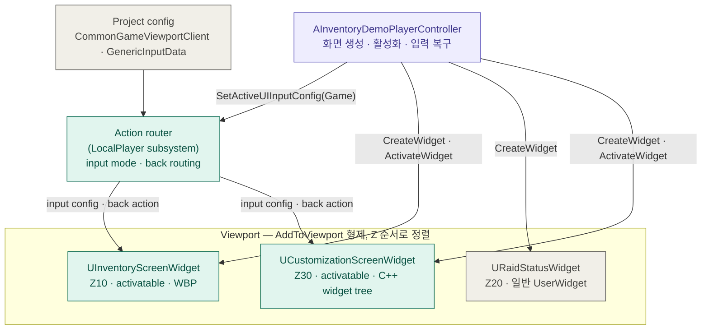
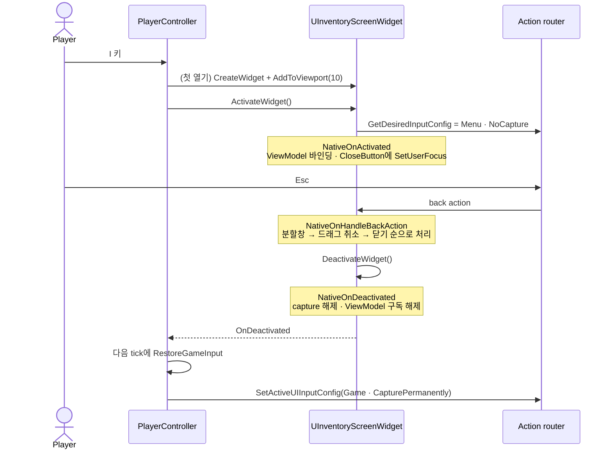
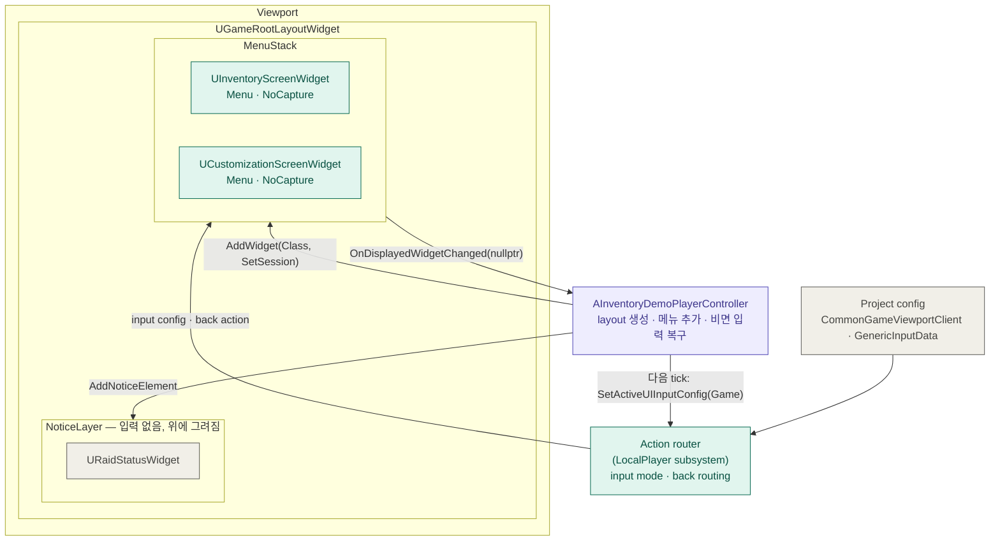
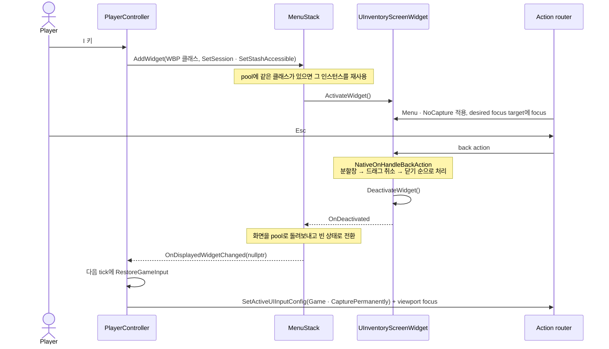
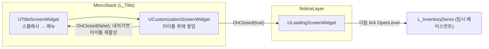
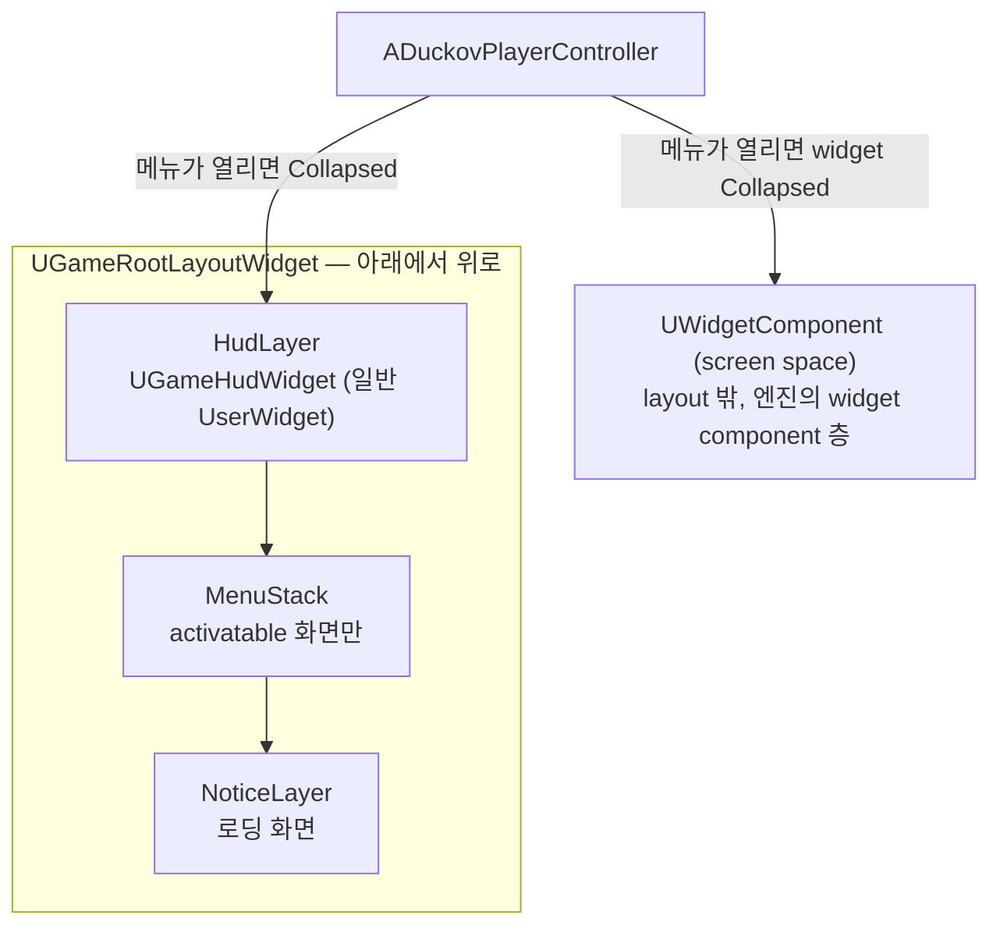
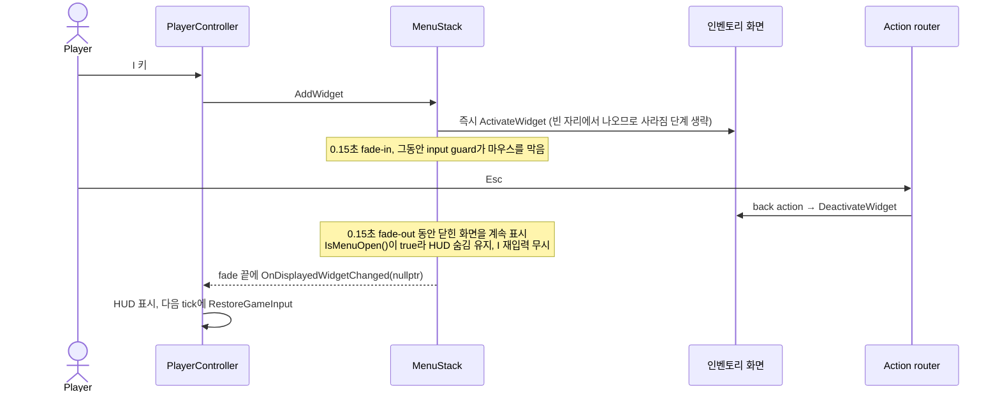
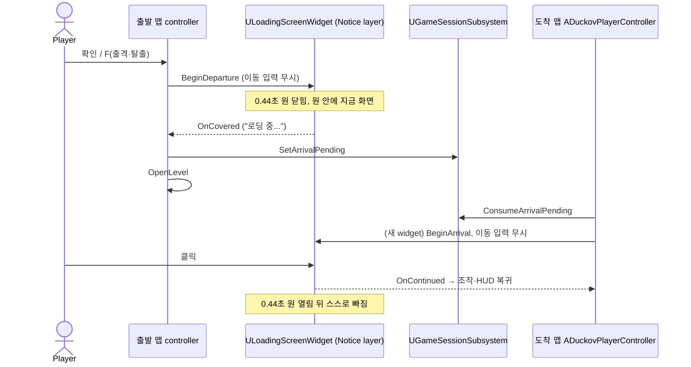

# CommonUI 적용 구조

이 문서는 CommonUI가 프로젝트에 어떻게 적용됐는지 그림으로 정리한다.
구조가 바뀌면 이전 상태를 지우지 않고 새 절을 추가해 전후를 비교할 수 있게 한다.

## 2026-10-11 — layer stack 도입 전

기준 커밋: `35de5a6`. 코드를 읽어 정리했으며 이번에 빌드·실행하지 않았다.

### 전체 구조

화면은 `AddToViewport`의 Z 순서로 viewport에 직접 붙는다. 화면을 만들고 열고 닫고,
닫은 뒤 입력을 되돌리는 일은 `AInventoryDemoPlayerController`가 화면마다 직접 처리한다.

청록은 CommonUI 타입, 보라는 게임 코드, 회색은 엔진 설정이나 일반 UMG다.

### 인벤토리 열기와 닫기

마지막 두 단계는 CommonUI가 자동으로 해 주지 않아 게임 코드가 직접 처리한다.

### 쓰고 있는 기능

| 기능 | 위치 |
| --- | --- |
| `UCommonActivatableWidget` 활성화·비활성화 lifecycle | `InventoryScreenWidget`, `CustomizationScreenWidget` |
| back handler(`bIsBackHandler`, `NativeOnHandleBackAction`) | 두 화면. 인벤토리는 분할창 → 드래그 → 닫기 순, 커스터마이징은 Back을 취소로 처리 |
| `GetDesiredInputConfig`(Menu · NoCapture) | 두 화면 |
| `NativeGetDesiredFocusTarget` | 인벤토리는 CloseButton(분할창이 열려 있으면 수량 입력), 커스터마이징은 PartA 버튼 |
| Action router의 input config 전환 | 화면 활성화 시 자동, 닫은 뒤의 Game 복구는 `RestoreGameInput`이 수동 처리 |
| `CommonGameViewportClient` | `Config/DefaultEngine.ini` |
| `CommonInputSettings`의 `GenericInputData` | `Config/DefaultGame.ini`. 엔진 샘플 데이터를 그대로 사용 |
| `CommonButtonAcceptKeyHandling=TriggerClick` | `Config/DefaultGame.ini` |

### 아직 쓰지 않는 기능

| 기능 | 현재 대체 방식 | 영향 |
| --- | --- | --- |
| `UCommonActivatableWidgetStack`, Root Layout | Z 순서와 controller의 화면별 분기 | 화면을 추가할 때마다 controller에 상호 검사가 늘어난다 |
| `UCommonButtonBase` | UMG `UButton` | CommonUI 버튼 스타일·입력 아이콘·포커스 스타일을 쓰지 못한다 |
| `CommonTextStyle`, `CommonBorderStyle` | 화면마다 개별 설정 | 공통 시각 체계가 없다 |
| `UCommonBoundActionBar` | 없음 | 하단 키 안내가 없다 |
| 프로젝트 전용 input action 데이터 | 엔진 샘플 `GenericInputData` | — |
| HUD의 CommonUI 편입 | `URaidStatusWidget`이 일반 `UserWidget` | HUD가 CommonUI 입력 흐름 밖에 있다 |

게임패드 입력은 장치가 없어 검증하지 못했다(not_run).

## 2026-10-11 — Menu stack 도입 후

결정과 버린 대안은 [CommonUI root layout과 Menu stack](architecture/021-commonui-layer-stack.md)에 있다.
아래는 Automation 95개 통과(2026-10-11) 기준의 구조다.

### 전체 구조

viewport에는 root layout 하나만 붙는다. 화면 순서는 Z값이 아니라 layout 안의 순서로 정해진다.
메뉴는 `MenuStack`에만 들어가므로 Router가 고를 활성 root는 표시 중인 메뉴 하나뿐이다.
그 위의 Notice layer는 입력을 갖지 않는 안내 표시 전용이며, 열린 메뉴 위에도 Raid 안내가 보이게 한다.

### 인벤토리 열기와 닫기

### 바뀐 점 요약

| 항목 | 이전 | 이후 |
| --- | --- | --- |
| 화면 순서 | `AddToViewport` Z값 10 / 20 / 30 | layout 안에서 `MenuStack` 위에 `NoticeLayer` |
| 화면 생성 | controller가 `CreateWidget` 후 직접 `ActivateWidget` | `MenuStack->AddWidget`이 생성·재사용·활성화 |
| 메뉴를 닫은 뒤 입력 | 화면마다 `OnDeactivated`에 복구를 걸고 다음 tick에 처리 | Menu stack이 비는 순간 한 곳에서 다음 tick에 처리 |
| 마우스 커서 | controller가 `bShowMouseCursor`를 직접 토글 | input config의 mouse capture 모드로 Router가 처리 |
| Raid 상태 표시 | viewport에 Z20으로 직접 추가 | `NoticeLayer`의 요소. 열린 인벤토리 위에 그려짐 |
| 아직 없는 것 | — | 메뉴 아래의 지상 플레이 HUD, Modal layer, `CommonButtonBase`, 공통 style, 하단 키 안내 |

### 버린 설계: 항상 활성인 HUD로 입력 복구

처음에는 Lyra처럼 HUD를 `GameStack`의 activatable로 두고 HUD의 Game input config로 복구하게 했다.
Router는 활성 root가 여럿이면 마지막으로 그려진 `LayerId`가 가장 높은 root를 고른다.
인벤토리를 막 열어 아직 그려지지 않은 프레임에 HUD가 이겨서, 열린 인벤토리 위에서 Game 입력이 켜졌다.
그래서 항상 활성인 root를 없애고 복구를 Menu stack 한 곳에 모았다. 근거와 실패 증거는 설계결정기록 021에 있다.

## 2026-10-11 — 타이틀 흐름

결정은 [타이틀 흐름과 레벨을 넘는 세션 상태](architecture/022-title-flow-and-session-state.md)에 있다.
타이틀 맵도 같은 root layout을 쓴다. 화면을 쌓고 내리는 일은 Menu stack이 맡고, controller는 무엇을 쌓을지만 정한다.

| 화면 | CommonUI에서 하는 일 |
| --- | --- |
| 타이틀 | Menu 입력, 스플래시에서는 화면 자체가 focus 대상이고 메뉴에서는 시작 버튼. Back은 소비만 하고 닫히지 않음 |
| 커스터마이징 | 기존 화면을 그대로 타이틀 위에 push. Back은 취소이며 stack이 타이틀을 다시 활성화 |
| 로딩 | activatable이 아님. Notice layer에 붙어 입력 경쟁에 끼지 않음 |

## 2026-10-14 — HUD layer와 물체에 붙는 프롬프트

결정은 [HUD layer와 물체에 붙는 상호작용 프롬프트](architecture/025-hud-layer-and-anchored-prompt.md)에 있다.
root layout에 Menu stack 아래 층이 하나 생겼다. HUD는 activatable이 아니라서, 위 절의 "항상 활성인 HUD" 문제를 다시 만들지 않는다.

| 요소 | 입력 | 갱신 |
| --- | --- | --- |
| HUD(장소, 조작 설명, 결과 문구) | 받지 않음(HitTestInvisible) | controller가 값이 바뀔 때만 |
| 상호작용 프롬프트 | 받지 않음 | 대상이 바뀔 때 붙일 곳 변경, 보이는 동안만 엔진이 위치 투영 |
| 메뉴 | Menu stack이 CommonUI 입력 전환 | 기존과 같음 |

## 2026-10-19 — Menu stack 화면 전환

결정은 [Menu stack 화면 전환](architecture/036-menu-stack-transition.md)에 있다.
층 구성은 그대로이고, `MenuStack`의 전환 시간만 0에서 0.3초(CommonUI 기본 `FadeOnly`·`Linear`)로 바뀌었다.
CommonUI switcher는 한 번에 한 화면만 그리므로 crossfade가 아니라 "사라짐 0.15초 → 나타남 0.15초"이고, 빈 자리 쪽 절반은 생략한다.

| 전환 | 바뀐 점 |
| --- | --- |
| 게임 → 메뉴 | 활성화·입력 적용은 그대로 즉시, 화면만 0.15초 fade-in |
| 메뉴 → 게임 | HUD와 Game 입력이 0.15초 fade-out 뒤에 돌아옴 |
| 메뉴 → 메뉴(타이틀 ↔ 커스터마이징) | 이전 화면은 즉시 비활성, 0.15초 뒤 새 화면 활성화, 다시 0.15초 fade-in |

## 2026-10-19 — 맵 이동 원형 전환과 도착 클릭 대기

결정은 [맵 이동 전환](architecture/037-map-travel-circle-wipe.md)에 있다. 로딩 화면은 여전히 activatable이 아니고 Notice layer에 붙는다.
Notice layer가 HUD·Menu stack 위에 있으므로 원형 마스크가 메뉴와 HUD까지 함께 덮는다. 맵을 넘는 신호는 세션의 일시 플래그 하나다.

