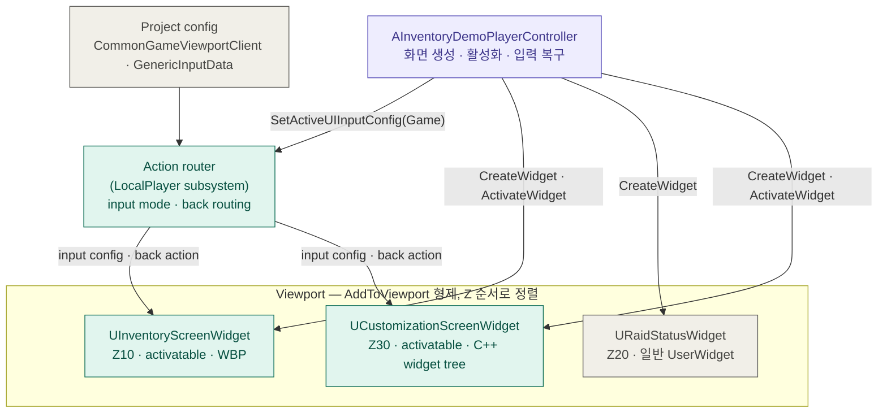
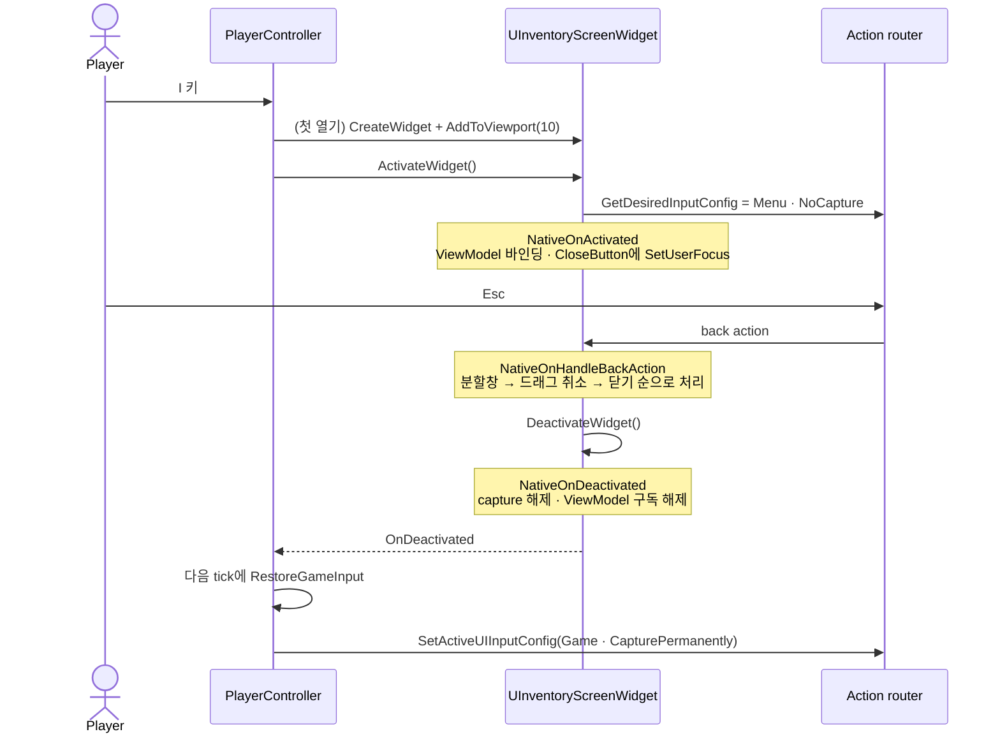

# CommonUI 적용 구조

이 문서는 CommonUI가 프로젝트에 어떻게 적용됐는지 그림으로 정리한다.
구조가 바뀌면 이전 상태를 지우지 않고 새 절을 추가해 전후를 비교할 수 있게 한다.

## 2026-10-11 — layer stack 도입 전

기준 커밋: `35de5a6`. 코드를 읽어 정리했으며 이번에 빌드·실행하지 않았다.

### 전체 구조

화면은 `AddToViewport`의 Z 순서로 viewport에 직접 붙는다. 화면을 만들고 열고 닫고,
닫은 뒤 입력을 되돌리는 일은 `AInventoryDemoPlayerController`가 화면마다 직접 처리한다.

청록은 CommonUI 타입, 보라는 게임 코드, 회색은 엔진 설정이나 일반 UMG다.

### 인벤토리 열기와 닫기

마지막 두 단계는 CommonUI가 자동으로 해 주지 않아 게임 코드가 직접 처리한다.

### 쓰고 있는 기능

| 기능 | 위치 |
| --- | --- |
| `UCommonActivatableWidget` 활성화·비활성화 lifecycle | `InventoryScreenWidget`, `CustomizationScreenWidget` |
| back handler(`bIsBackHandler`, `NativeOnHandleBackAction`) | 두 화면. 인벤토리는 분할창 → 드래그 → 닫기 순, 커스터마이징은 Back을 취소로 처리 |
| `GetDesiredInputConfig`(Menu · NoCapture) | 두 화면 |
| `NativeGetDesiredFocusTarget` | 인벤토리는 CloseButton(분할창이 열려 있으면 수량 입력), 커스터마이징은 PartA 버튼 |
| Action router의 input config 전환 | 화면 활성화 시 자동, 닫은 뒤의 Game 복구는 `RestoreGameInput`이 수동 처리 |
| `CommonGameViewportClient` | `Config/DefaultEngine.ini` |
| `CommonInputSettings`의 `GenericInputData` | `Config/DefaultGame.ini`. 엔진 샘플 데이터를 그대로 사용 |
| `CommonButtonAcceptKeyHandling=TriggerClick` | `Config/DefaultGame.ini` |

### 아직 쓰지 않는 기능

| 기능 | 현재 대체 방식 | 영향 |
| --- | --- | --- |
| `UCommonActivatableWidgetStack`, Root Layout | Z 순서와 controller의 화면별 분기 | 화면을 추가할 때마다 controller에 상호 검사가 늘어난다 |
| `UCommonButtonBase` | UMG `UButton` | CommonUI 버튼 스타일·입력 아이콘·포커스 스타일을 쓰지 못한다 |
| `CommonTextStyle`, `CommonBorderStyle` | 화면마다 개별 설정 | 공통 시각 체계가 없다 |
| `UCommonBoundActionBar` | 없음 | 하단 키 안내가 없다 |
| 프로젝트 전용 input action 데이터 | 엔진 샘플 `GenericInputData` | — |
| HUD의 CommonUI 편입 | `URaidStatusWidget`이 일반 `UserWidget` | HUD가 CommonUI 입력 흐름 밖에 있다 |

게임패드 입력은 장치가 없어 검증하지 못했다(not_run).
