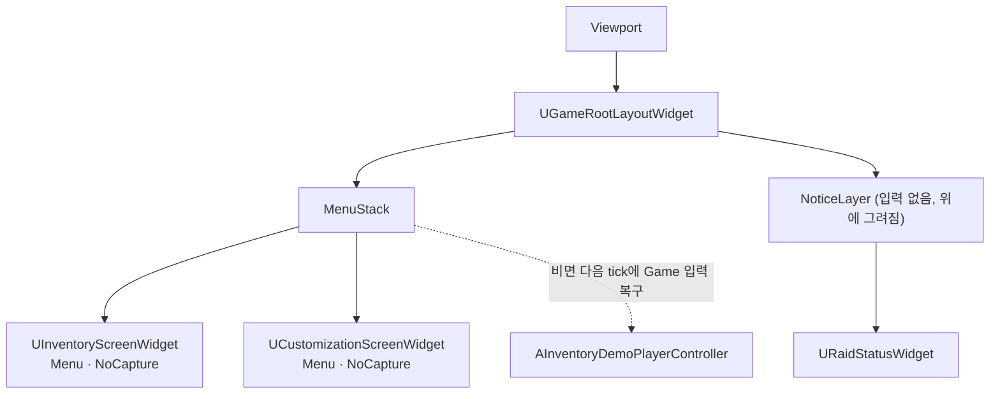

# 설계결정기록 021 — CommonUI root layout과 Menu stack

| 항목 | 내용 |
| --- | --- |
| 상태 | Accepted |
| 날짜 | 2026-10-11 |
| 작업 범위 | M3 / 화면 골격 — 타이틀·베이스먼트 화면 추가 전 |
| Risk | LOW — 공개 함수·저장 형식·Config·플러그인·모듈 의존을 바꾸지 않는다. 바뀌는 것은 화면을 viewport에 붙이는 경로와 메뉴를 닫은 뒤 입력 복구를 거는 위치이며 되돌릴 수 있다 |
| 판단 주체 | AI(위임 범위) |
| 사용자 검토 | 검토 완료 — 사용자 PIE 확인(2026-10-20 사용자 진술로 정정, 이전 기록: 미검토). 사용자 보고이며 AI 직접 관찰 아님 |
| 관련 | Editor 인벤토리 화면의 소유와 입력 연결(016), `docs/COMMONUI_STRUCTURE.md` |

## Context / Decision Question

지금까지 화면은 `AddToViewport`의 Z값(인벤토리 10, Raid 상태 20, 커스터마이징 30)으로 쌓였다.
`AInventoryDemoPlayerController`가 화면마다 만들기·열기·닫기를 처리하고, 화면마다 `OnDeactivated`에
입력 복구를 걸었다. 다음 작업에서 타이틀·베이스먼트·HUD 화면이 늘어난다. 이 방식이면 화면이 하나 늘 때마다
controller의 상호 검사, Z값, delegate 연결이 함께 늘어난다. 화면 순서와 입력 전환을 어디에 맡길지 정한다.

엔진 코드에서 확인한 사실(UE 5.7 CommonUI):

- 활성화된 화면이 모두 사라져도 Router는 Game 입력·viewport mouse capture·커서를 되돌리지 않는다.
  pool 구조에서는 화면 Slate가 해제되며 root가 비어 config 값 자체는 초기화되지만(`ActiveInputConfig.Reset()`), viewport 상태는 그대로 남는다.
- 활성 root가 여러 개면 Router는 매 tick, Slate가 마지막으로 그린 `LayerId`가 가장 높은 root를 active root로 고른다.
  막 활성화되어 아직 그려지지 않은 화면은 이 값이 0이거나 이전 값이다.
- `UCommonActivatableWidgetStack`은 화면이 비활성화되면 pool로 돌려보내고, 같은 클래스로 다시 열면 그 인스턴스를 재사용한다.
  전환 애니메이션 중에는 입력을 막는다.

## Decision / Rationale

- viewport에는 `UGameRootLayoutWidget` 하나만 붙인다. 이 layout은 `MenuStack` 위에 `NoticeLayer`(일반 `UOverlay`)를 겹쳐 둔다.
  Z값은 쓰지 않는다.
- 인벤토리와 커스터마이징은 `MenuStack->AddWidget(Class, Init)`으로 연다. 세션 주입(`SetSession`, `SetStashAccessible`)은
  init 함수에서 활성화 전에 한다.
- 안내 표시는 activatable root로 두지 않는다. Raid 상태처럼 열린 메뉴 위에도 보여야 하는 안내는 입력을 갖지 않는
  `NoticeLayer`에 붙인다. 이전 Z값(인벤토리 10 아래, Raid 상태 20 위)과 같은 순서다. Router는 activatable root끼리만 비교하므로
  Router가 고를 활성 root는 Menu stack에 표시된 화면 하나뿐이다. 메뉴 아래에 깔릴 지상 플레이 HUD는 그 작업에서 layer를 추가한다.
- 입력 복구는 화면마다가 아니라 **Menu stack이 비는 순간 한 곳**에서 건다. controller가 `OnDisplayedWidgetChanged(nullptr)`를 받으면
  다음 tick에 Game · CapturePermanently를 적용하고 viewport에 focus를 준다. 다음 tick 처리와 적용 내용은 이전에 검증된 방식 그대로다.
- 전환 시간은 0으로 둔다. 전환 중 입력 차단이 기존 열기·닫기 반응과 테스트 가정을 바꾸기 때문이다.
  (2026-10-19 이 항목은 [설계결정기록 036](036-menu-stack-transition.md)이 대체했다. 지금은 0.3초 FadeOnly 전환이다.)
- 기존 controller의 공개 함수(`ToggleInventory`, `OpenCustomizationPrototype`, Raid 함수)와 멤버 이름(`Screen`, `CustomizationScreen`,
  `RaidStatus`, `Model`)은 유지한다. 커스터마이징 중 인벤토리 진입 차단 같은 기존 규칙도 그대로 둔다.
- Modal layer는 만들지 않았다. 지금 modal로 옮길 화면이 없고, 분할 수량창은 인벤토리 화면 내부 overlay로 남아 있다.

## Alternatives / Trade-offs

- **HUD를 항상 활성인 activatable로 두고 그 Game input config로 복구(Lyra식) — 구현 후 폐기.**
  처음에는 `GameStack`의 HUD가 Game · CapturePermanently를 갖게 해서 수동 복구를 없앴다.
  실제 PIE에서 인벤토리를 연 프레임에 Menu 입력이 적용됐다가, 다음 프레임에 Router가 HUD를 다시 active root로 골라
  Game 입력으로 되돌아갔고, 이후 인벤토리로 돌아오지 않았다. `Duckov.UI.PIEInputLifecycle`과 `Duckov.UI.PIELifecycle`이 실패했다.
  진단 로그를 넣은 다른 실행에서는 인벤토리가 그려진 뒤에 active root가 되어 정상 동작했고, 이때 layer는 인벤토리 73, HUD 51이었다.
  즉 재현 여부는 활성화와 첫 paint의 순서에 달려 있었다. 실패한 실행에서 Router가 인벤토리로 돌아오지 않은 정확한 원인은 확정하지 못했다. 실패 증거는 `Saved/Automation/LayerStack/Targeted/`와
  `Saved/Logs/LayerStack.log`, `LayerStackTargeted.log`에 있다. 항상 활성인 root가 메뉴와 경쟁하지 않게 하는 것이 이번 선택의 이유다.
- **Lyra식 GameInstance/LocalPlayer UI 관리자 subsystem과 layer 태그 등록**: 여러 맵과 여러 local player에서 layout을 공유하기 좋다.
  지금은 맵 하나·player 하나이고 맵 분리는 다음 작업이라, 지금 만들면 쓰이지 않는 추상화가 된다.
- **Z값 구조를 유지하고 입력 복구만 정리**: 변경은 가장 작지만, 화면이 늘수록 controller의 분기가 늘어나는 문제가 남는다.
- **`AddWidgetInstance`로 기존 인스턴스를 직접 넣기**: 엔진이 legacy 경로로 표시하고, class 기반 `AddWidget`도
  pool에서 같은 인스턴스를 재사용하므로 이점이 없다.

## Consequences / Accepted Costs

- 입력 복구는 여전히 게임 코드 한 곳(`OnMenuChanged` → `RestoreGameInput`)에 있다. CommonUI만으로 복구하는 구조는 아니다.
  대신 화면 수와 무관하게 한 곳이다.
- 화면을 닫으면 stack이 Slate 위젯을 해제하고, 다시 열면 다시 만든다(UObject는 재사용). 이전에는 Collapsed로 숨기기만 했다.
  열 때마다 `NativeConstruct`가 다시 불린다. 기존 화면은 활성화 시점에 ViewModel을 다시 바인딩하므로 동작은 같다.
- 화면이 viewport에 직접 붙지 않으므로 `UUserWidget::IsInViewport()`는 false다. 기존 lifecycle 테스트의 해당 검사 3곳은
  "root layout이 viewport에 있고 Menu stack의 활성 화면이 그 화면인가"로 바꿨다.
- controller는 더 이상 화면의 `OnDeactivated`에 묶이지 않고 Menu stack의 `OnDisplayedWidgetChanged`에 묶인다.
  기존 lifecycle 테스트의 "Screen deactivation delegate 연결(travel 전)/제거(cleanup)" 검사는 이 새 binding의 연결/해제 검사로 바꿨다.
  기존 검사를 그대로 두면 travel 뒤에도 실패했다(`Saved/Logs/LayerStackTargeted2.log`). controller가 아닌 어떤 listener가 이전 화면의
  `OnDeactivated`에 남아 있다는 뜻이다. 후보는 Router의 activatable tree node지만 확인하지 못했다. 이전 화면과 Model이 GC되는지는 같은 테스트가 계속 검사한다.
- pool은 init 함수(`SetSession`)보다 먼저 화면의 Construct를 호출한다. 지금 Construct에서 Model에 의존하는 화면은 없지만,
  앞으로 Construct에서 세션 값을 쓰면 안 된다.
- layout은 controller 소유라서 레벨이 바뀌면 함께 사라진다. 맵을 나누는 다음 작업에서 다시 검토한다.

## Revisit Conditions

- 타이틀·베이스먼트·레이드로 맵을 나눌 때: layout 소유를 controller에서 LocalPlayer 쪽으로 옮길지 정한다.
- 입력을 갖는 HUD(예: 상호작용 프롬프트에 focus가 필요한 HUD)가 필요해질 때: 위 폐기 대안의 race를 해결한 뒤에만 activatable HUD를 둔다.
- modal 화면(확인창 등)이 생길 때: `ModalStack`을 추가한다.
- 화면 전환 애니메이션이 필요할 때: 전환 중 입력 차단을 허용할지 정한다.

## Verification

2026-10-11 실행 결과. 증거는 `Saved/Automation/LayerStack/`와 `Saved/Logs/LayerStack*.log`에 있다.

- Editor Win64 Development, Editor `-DisableAdaptiveUnity`(Unity 묶음 `Module.DuckovLike.2.cpp` 실제 compile), Game Win64 Development:
  각각 `Result: Succeeded`.
- 새 process 전체 Automation(`Duckov.+InventoryAssets.Verify+CustomizationAssets.Verify`): **95 succeeded / 0 failed / 0 notRun**
  (`Saved/Automation/LayerStack/Final2`). 이전 94개 경로 누락 0, 새 경로는 `Duckov.UI.LayerStack` 1개.
- `Duckov.UI.LayerStack`이 확인하는 것: layout 하나만 viewport에 붙음, 메뉴가 Menu stack에 표시되고 viewport에 직접 붙지 않음,
  연 뒤 10 프레임 동안 Menu 입력과 active root 유지(폐기한 설계의 실패 지점), 닫은 뒤 Game 입력과 viewport focus 복구,
  재개방 시 같은 인스턴스, 커스터마이징도 같은 경로, Raid 상태가 Notice layer에 붙고 열린 인벤토리보다 높은 layer로 그려짐.
- 독립 검토: 별도 문맥의 cpp-reviewer가 PASS와 함께 2건을 지적했다. Raid 안내가 열린 인벤토리 배경에 가려지는 회귀(MEDIUM)와,
  좁힌 lifecycle 검사가 항상 통과하고 새 binding을 검사하지 않는 공백(LOW)이다. 두 건 모두 위 구조와 테스트로 반영했고,
  반영 후 위 빌드와 전체 Automation을 다시 실행했다. reviewer는 build·runtime을 직접 실행하지 않았고, 반영분은 재검토받지 않았다.
- 폐기한 설계의 실패 실행과 CEF 크래시: 첫 전체 실행은 PIEInputLifecycle 실패 뒤 PIELifecycle 대기 중
  엔진 CEF WebBrowser assertion(`BUseSupportedRHIRenderer`)으로 종료됐다(exit 3, 리포트 없음). 최종 구조의 전체 실행에서는 재현되지 않았고,
  원인은 확정하지 못했다.
- 미검증: 사람의 직접 PIE 조작, 게임패드, packaged/Shipping 실행.
