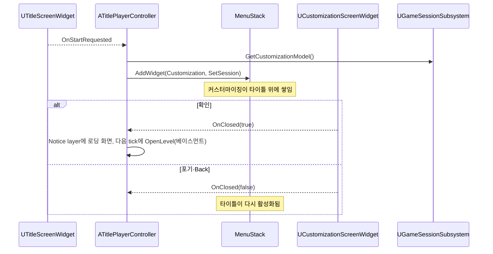

# 설계결정기록 022 — 타이틀 흐름과 레벨을 넘는 세션 상태

| 항목 | 내용 |
| --- | --- |
| 상태 | Accepted |
| 날짜 | 2026-10-11 |
| 작업 범위 | M3 / 게임 흐름 — 타이틀 → 게임 시작 → 커스터마이징 → 베이스먼트 |
| Risk | LOW — 저장 형식·공개 함수·모듈 의존을 바꾸지 않는다. 시작 맵 설정과 커스터마이징 Model의 소유 위치가 바뀌며 되돌릴 수 있다 |
| 판단 주체 | AI(위임 범위). 흐름 순서는 사용자 지시 |
| 사용자 검토 | 미검토 |
| 관련 | CommonUI root layout과 Menu stack(021), Editor 인벤토리 화면의 소유와 입력 연결(016), `docs/DUCKOV_UI_REFERENCE.md` |

## Context / Decision Question

사용자가 정한 인게임 흐름은 첫 UI → 게임 시작 → 커스터마이징 → 베이스먼트 → 레이드 → 루팅 → 복귀다.
지금까지는 데모 맵 하나에서 콘솔 명령으로 각 기능을 열었다. 이번에는 앞부분(첫 UI부터 베이스먼트까지)을 실제 맵 이동으로 잇는다.
커스터마이징에서 확정한 외형은 레벨이 바뀌어도 남아야 하는데, 지금 커스터마이징 Model은 데모 PlayerController가 소유해
레벨이 바뀌면 사라진다.

## Decision / Rationale

- 새 `L_Title` 맵이 게임 시작 맵(`GameDefaultMap`)이다. `ATitleGameMode`는 pawn 없이 `ATitlePlayerController`만 둔다.
- 타이틀 controller는 설계결정기록 021의 root layout을 그대로 쓴다. `UTitleScreenWidget`이 Menu stack의 바닥이고,
  게임 시작을 누르면 기존 `UCustomizationScreenWidget`이 그 위에 쌓인다.
  - 포기·Back: 커스터마이징이 내려가면서 stack이 아래의 타이틀을 다시 활성화한다. 타이틀은 메뉴 상태로 돌아온다.
  - 확인: `ULoadingScreenWidget`을 Notice layer에 붙이고, 그 화면이 한 번 그려진 다음 tick에 베이스먼트로 `OpenLevel`한다.
    불러오는 동안 마지막으로 그려진 로딩 화면이 남는다.
- 커스터마이징 화면은 어떻게 닫혔는지 `OnClosed(bApplied)`로 알린다. 다음 흐름은 화면이 아니라 화면을 연 쪽이 정한다.
- 레벨을 넘는 상태는 `UGameSessionSubsystem`(GameInstance subsystem)이 소유한다. 지금은 커스터마이징 Model 하나뿐이다.
  베이스먼트의 데모 controller도 커스터마이징을 열 때 이 Model을 쓴다. 그래서 타이틀에서 확정한 외형을 이어서 편집한다.
- 타이틀 화면은 원작의 구조를 따른다: 스플래시 → 같은 배경 위 왼쪽 세로 pill 메뉴, 주 동작만 초록·크게.
  기능이 있는 항목(게임 시작, 게임 종료)만 둔다.
- 전용 베이스먼트 맵을 만들기 전까지는 기존 `L_InventoryDemo`가 베이스먼트다.
- 인벤토리 Model은 이번에 옮기지 않는다. 레이드 맵을 나눠 인벤토리가 레벨을 넘어야 할 때 같은 subsystem으로 옮긴다.

## Alternatives / Trade-offs

- **커스터마이징 전용 맵을 두고 타이틀 → 커스터마이징 → 베이스먼트로 맵을 두 번 이동**: 원작처럼 3D 공간에서 편집할 수 있다.
  하지만 지금 미리보기는 render target 위젯이라 맵이 따로 필요 없고, 이동마다 로딩이 한 번 더 생긴다.
- **확정한 프로필 값만 GameInstance에 복사**: 소유 범위는 더 좁다. 하지만 베이스먼트에서 다시 편집할 때 같은 Model과
  Draft·Profile 계약을 그대로 쓰는 편이 상태 복제가 없다.
- **비동기 로딩 화면(MoviePlayer / loading screen module)**: 로딩 중에도 애니메이션이 움직인다. 지금 맵은 작아서 로딩이 짧고,
  모듈과 설정이 늘어난다. 정적인 로딩 화면 한 장으로 충분하다.
- **원작 메뉴 항목 전부(세이브 슬롯, Mods, 설정, 제작진)를 배치**: 원작과 더 닮지만 동작하지 않는 버튼이 생긴다.

## Consequences / Accepted Costs

- 커스터마이징 Model의 수명이 PlayerController에서 GameInstance로 늘었다. PIE 한 번 안에서는 레벨을 이동해도 같은 Model이다.
  PIE를 끝내면 GameInstance와 함께 사라지며, 디스크 저장은 없다.
- 시작 맵이 바뀌었다. 에디터에서 데모 맵을 직접 열어 PIE를 하는 기존 방식은 그대로 동작한다.
- 게임 시작 직후에는 viewport가 아직 focus 경로에 없어 Router가 focus를 주지 않을 수 있다. 타이틀 화면은 다른 화면처럼
  활성화될 때 직접 `SetUserFocus`를 호출한다.
- 이동 대상 맵은 문자열 경로로 지정한다. 이동이 실패하면(예: 대상 맵이 cook되지 않음) 로딩 화면이 남고 게임 시작이 막힌다.
  지금은 cook 대상 맵을 제한하지 않아 모든 맵이 cook되므로 이 실패는 생기지 않는다. 이동 실패 처리는 넣지 않았다.
- 기본 글꼴에는 한글 Bold가 없어서 Bold 지정이 한글에 적용되지 않는다. 글꼴과 공통 style은 UI 개편 작업에서 다룬다.

## Revisit Conditions

- 전용 베이스먼트·레이드 맵을 만들 때: 이동 대상 맵과 인벤토리 Model의 소유를 이 subsystem으로 옮긴다.
- 세이브가 생길 때: 계속하기·세이브 슬롯 메뉴와 subsystem 상태의 저장·복원을 정한다.
- 로딩이 길어질 때: 비동기 로딩 화면을 검토한다.
- 패키징에서 cook 대상 맵을 제한할 때: 타이틀·베이스먼트 맵을 목록에 넣고, 이동 실패 시 로딩 화면을 내리는 처리를 추가한다.

## Verification

2026-10-11 실행 결과. 증거는 `Saved/Automation/TitleFlow/`, `Saved/Logs/TitleFlow*.log`에 있다.

- `TitleAssets.Create`(명시 실행, 기존 맵 덮어쓰기 거부): 1 succeeded, `Content/Maps/L_Title.umap` 생성.
- Editor, Editor `-DisableAdaptiveUnity`, Game Win64 Development 빌드: 각각 `Result: Succeeded`.
- 새 process 전체 Automation: **97 succeeded / 0 failed / 0 notRun**(`Final2`). 이전 95개 경로 누락 0, 새 경로 2개.
  - `Duckov.Title.Assets`: 시작 맵 설정, 타이틀 맵의 GameMode, pawn 없음, controller 클래스.
  - `Duckov.Title.FlowToBasement`: 스플래시 focus, 아무 키로 메뉴, 시작 버튼 focus와 Enter, 커스터마이징이 타이틀 위에 쌓임,
    Back으로 타이틀 메뉴 복귀(맵 이동 없음), 다시 시작해 눈 크기 0.5로 확인, 로딩 화면이 Notice layer에 붙음,
    베이스먼트 이동 뒤 같은 GameInstance·같은 세션 Model·값 0.5 유지, 베이스먼트 커스터마이징도 같은 Model 사용.
  - 실제 Slate 입력 경로는 첫 진입(Space, Enter)과 Back만 확인한다. 두 번째 게임 시작과 확인은 버튼의 `OnClicked`를 직접 broadcast하므로
    handler 연결만 확인한다. pool 재사용 시 `OnClosed`가 한 번만 묶이는지는 결과가 같아 관찰하지 못한다.
- 독립 실행(`-game`)으로 시작 맵이 타이틀임을 확인하고, 스플래시와 메뉴 화면을 캡처해 레퍼런스와 비교했다.
  메뉴 전환에는 AI가 띄운 테스트 창에만 클릭 메시지를 보냈다.
- 첫 흐름 테스트 실행은 테스트 코드의 null 참조로 크래시했다(`Saved/Logs/TitleFlowTargeted.log`). 원인은 PIE 시작 시 타이틀 focus가
  잡히지 않은 것이었고, 화면의 직접 focus와 테스트의 null 방어로 고쳤다.
- 독립 검토: 별도 문맥의 cpp-reviewer가 PASS, LOW 3건을 지적했다. 이동 실패 시 로딩 화면 잔류는 위 비용과 재검토 조건으로 기록했고,
  테스트의 null 방어 2곳을 보강했으며, 테스트가 관찰하는 범위를 위 항목처럼 고쳐 적었다. reviewer는 build·runtime을 직접 실행하지 않았다.
  보강 뒤에는 Editor `-DisableAdaptiveUnity` 빌드(`Result: Succeeded`)와 `Duckov.Title` 2개(2 succeeded)만 다시 실행했다. 전체 97개는 보강 전 코드 기준이다.
- 미검증: 사람의 직접 조작, 스플래시 마우스 클릭의 자동 검사, 커스터마이징이 쌓인 상태의 종료 경로, 게임패드,
  패키징·Shipping 빌드, 게임 종료 버튼의 실제 종료.
