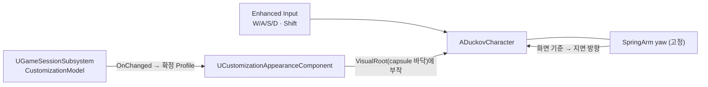

# 설계결정기록 023 — 지상 플레이 캐릭터와 베이스먼트 맵

| 항목 | 내용 |
| --- | --- |
| 상태 | Accepted |
| 날짜 | 2026-10-11 |
| 작업 범위 | M3 / 지상 플레이 — 베이스먼트에서 커스터마이징한 오리를 조작 |
| Risk | LOW — 새 맵·클래스 추가와 타이틀의 이동 대상 변경이다. 외형 컴포넌트에는 기본값이 기존 동작인 선택 API만 더했다 |
| 판단 주체 | AI(위임 범위). 흐름과 작업 순서는 사용자 지시 |
| 사용자 검토 | 검토 완료 — 사용자 PIE 확인(2026-10-20 사용자 진술로 정정, 이전 기록: 미검토). 사용자 보고이며 AI 직접 관찰 아님 |
| 관련 | 타이틀 흐름과 레벨을 넘는 세션 상태(022), CommonUI root layout과 Menu stack(021), `docs/DUCKOV_UI_REFERENCE.md` |

## Context / Decision Question

지금까지 플레이어는 데모 맵의 기본 비행 pawn이었다. 사용자가 정한 흐름의 베이스먼트에서는 커스터마이징한 오리를 직접 움직여야 한다.
원작에서 관찰한 조작은 화면 기준 WASD, Shift 달리기, 고정 각도의 높은 탑다운 카메라, 마우스 조준, 상호작용 프롬프트다.
이번 작업에서 어디까지 만들고, 기존 데모 맵과 테스트를 어떻게 보존할지 정한다.

## Decision / Rationale

- **`ADuckovCharacter`(ACharacter)**: capsule은 오리 키 91 cm에 맞춘 고정 크기다. 외형 조절 값이 판정 크기를 바꾸지 않는다.
  카메라는 절대 회전 SpringArm(pitch -55, yaw -40, 길이 1500, lag)이라 캐릭터가 돌아도 시점이 돌지 않는다.
  이동은 SpringArm의 yaw로 화면 위·오른쪽을 지면 방향으로 바꿔 넣고, 캐릭터는 진행 방향을 바라본다. Shift는 최대 속도만 바꾼다.
- **Enhanced Input을 C++에서 구성**: Move(Axis2D)·Sprint 액션과 mapping context를 캐릭터의 default subobject로 만든다.
  A/D는 Swizzle로 Y축, S/A는 Negate로 음수가 된다. 에셋을 따로 만들지 않아 코드 한 곳에서 키 배치를 읽을 수 있다.
  인벤토리 같은 메뉴가 열려 있는 동안에는 이동 키를 눌러도 움직이지 않는다(실제 키 입력 테스트로 확인).
- **외형**: 기존 `UCustomizationAppearanceComponent`를 그대로 쓰고, 표시 mesh를 붙일 부모를 지정하는 `SetAttachParent`만 더했다.
  발밑 원점 mesh를 capsule 바닥의 `VisualRoot`에 붙인다. 캐릭터는 세션 Model의 변경 통지를 구독하고 **확정된 Profile**만 다시 적용한다.
- **`L_Basement` + `ABasementGameMode`**: 바닥·벽 두 면·상자·조명·PlayerStart만 있는 임시 방이다. 명시 실행 명령으로 만든다.
  controller는 기존 `AInventoryDemoPlayerController`를 재사용해 인벤토리(I)와 커스터마이징을 그대로 연다.
  타이틀의 확인 흐름은 이제 이 맵으로 이동한다.
- **기존 `L_InventoryDemo`는 그대로 둔다**: 바닥이 없는 자동 테스트용 데모 맵이라 Character를 넣으면 떨어진다.
  인벤토리·Raid·loot 회귀 테스트는 계속 이 맵과 비행 pawn을 쓴다.
- **이번에 넣지 않은 원작 요소**: 마우스 조준·조준선·카메라 look-ahead(사격이 범위 밖), 구르기·animation(에셋 없음, 기본 포즈로 이동),
  상호작용 프롬프트(창고·출격 지점과 함께 다음 작업에서 구현).

## Alternatives / Trade-offs

- **`L_InventoryDemo`에 바닥을 깔고 pawn을 Character로 교체**: 맵이 하나로 유지된다. 하지만 loot 위치·탈출 거리·데모 pawn 이동을
  전제로 한 기존 회귀 테스트를 함께 고쳐야 하고, 데모 맵과 실제 흐름의 맵이 섞인다.
- **입력 액션·mapping context를 에셋으로 생성**: 에디터에서 키를 바꾸기 쉽다. 지금은 키가 고정이고, 에셋 생성 명령과 검증 테스트가 하나 더 필요하다.
- **외형을 별도 자식 actor로 붙이기**: 컴포넌트 수정이 필요 없다. 대신 actor가 하나 더 생기고 수명·부착 관리가 늘어난다.
  선택 API 하나가 더 작다.

## Consequences / Accepted Costs

- 오리는 animation 없이 reference pose로 미끄러지듯 움직인다.
- 외형 mesh의 정면 축은 import 결과에 의존한다. 원본 README의 forward(-Y)와 달리 UE에서는 +X가 정면이었다.
  처음에 넣은 90° 보정은 독립 실행 화면에서 부리 방향으로 틀린 것을 확인하고 제거했다. 테스트가 외형 정면과 진행 방향의 일치를 검사한다.
- 자동 실행 중 캐릭터 생성 직후 프레임이 길어지면 엔진이 `CharacterMovement` 반복 한도 경고를 남긴다. 결과에는 영향이 없다.
- 베이스먼트 controller가 데모 controller라서 Raid 데모 키(F5/F6)도 남아 있다. 베이스먼트·레이드 흐름 작업에서 정리한다.
- 타이틀 흐름의 목적지가 `L_InventoryDemo`에서 `L_Basement`로 바뀌어, 사용자 수용을 받은 월드 loot 획득·최소 Raid 데모는
  이제 정상 흐름으로 가지 않는다. 데모 맵을 직접 열거나 자동 테스트로만 확인한다. 레이드 맵 작업에서 실제 흐름으로 다시 잇는다.
- mapping context는 캐릭터마다 따로 만든다. 빙의가 바뀌면 이전 controller에서 빼고 새 controller에 넣는다.

## Revisit Conditions

- 사격·조준을 넣을 때: 마우스 위치 기반 회전, 조준선, 카메라 look-ahead를 추가하고 커서·mouse capture 설정을 다시 정한다.
- animation 에셋이 생길 때: 기본 포즈 고정(`SetForceRefPose`)을 풀고 animation 경로를 붙인다.
- 상호작용·창고·출격 지점을 만들 때: 베이스먼트 전용 controller와 데모 controller의 역할을 나눈다.

## Verification

2026-10-11 실행 결과. 증거는 `Saved/Automation/Basement/`, `Saved/Logs/Basement*.log`에 있다.

- `BasementAssets.Create`(명시 실행, 기존 맵 덮어쓰기 거부): 1 succeeded, `Content/Maps/L_Basement.umap` 생성.
- Editor `-DisableAdaptiveUnity`(`UnityEditorBuild-v3.log`), Game Win64 Development(`GameBuild-v2.log`): 각각 `Result: Succeeded`.
- 새 process 전체 Automation(`-nocefaccelpaint`): **98 succeeded + 1 succeededWithWarnings / 0 failed / 0 notRun**(`Final5`).
  이전 97개 경로 누락 0, 새 경로 2개. 경고는 캐릭터 생성 직후 프레임 정지에서 나온 엔진 `CharacterMovement` 반복 한도 로그다.
  - `Duckov.Basement.Assets`: GameMode·pawn·controller 클래스, PlayerStart 하나, 바닥 충돌.
  - `Duckov.Basement.CharacterMovement`: 착지, 세션 Profile 외형 표시와 capsule 바닥 부착, 확정 색상 변경 즉시 반영,
    실제 Slate 키 입력으로 W(화면 위, 504 cm)·A(왼쪽)·S(아래)·Shift+D(오른쪽, 걷기보다 빠름), 진행 방향 바라보기,
    카메라 각도 고정, 외형 정면과 진행 방향 일치, 인벤토리가 열린 동안 W 무시, 닫은 뒤 Game 입력 복귀.
  - `Duckov.Title.FlowToBasement`: 타이틀 확인 뒤 베이스먼트에서 지상 캐릭터를 조작.
- 독립 실행(`-game`)으로 오리가 바닥에 서고, W에서는 등을, D에서는 오른쪽을 향한 부리를 화면 캡처로 확인했다.
  이 확인에서 처음 넣은 +90° 보정이 틀린 것을 찾아 제거했다. 키 입력은 AI가 띄운 테스트 창에만 보냈다.
- 실패 기록
  - 첫 전체 실행은 W hold를 벽시계 0.6초로 재서, 1.8초 프레임 정지 때 13 cm만 이동해 실패했다(`Final`). 월드 시간과 프레임 수 기준으로 바꿨다.
  - 리뷰 반영 뒤 두 번의 전체 실행은 엔진 CEF assertion(`BUseSupportedRHIRenderer`)으로 에디터가 종료됐다(`BasementFinal3.log`, `BasementFinal4.log`, 리포트 없음).
    엔진 코드는 Automation 중 CEF 가속 그리기를 지원하지 않는다고 판정하는데, 시작 시 만든 브라우저가 테스트 중 다시 그려지면 assertion이 난다.
    `-nocefaccelpaint`로 실행해 통과했다.
- 독립 검토: 별도 문맥의 cpp-reviewer가 PASS, LOW 2건을 지적했다. 테스트의 null 역참조 가능성(모든 단계에 유효성 검사 추가)과
  빙의 교체 시 이전 mapping context 잔류(이전 controller에서 제거)를 반영했고, 지적된 커버리지 공백인 S·A 키 입력 검사를 추가했다.
  reviewer는 build·runtime을 직접 실행하지 않았고 반영분은 재검토받지 않았다.
- 미검증: 사람의 직접 조작, 키를 누른 채 메뉴를 여는 경우, 빙의 교체 경로(현재 코드에 없음), 게임패드, 패키징·Shipping.
