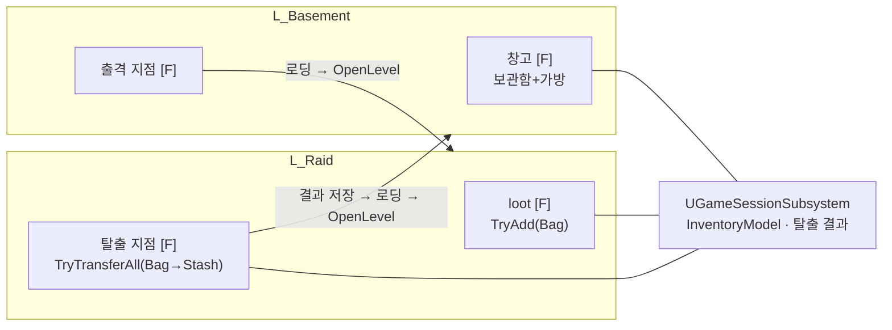

# 설계결정기록 024 — 월드 오브젝트 상호작용과 레벨을 넘는 레이드 루프

| 항목 | 내용 |
| --- | --- |
| 상태 | Accepted |
| 날짜 | 2026-10-13 |
| 작업 범위 | M3 / 베이스먼트 → 레이드 → 루팅 → 복귀 |
| Risk | LOW — 새 클래스·맵 추가, 베이스먼트 controller 교체, 인벤토리 Model 소유 위치 이동. 저장 형식·InventoryCore·기존 데모 맵과 데모 controller는 바꾸지 않는다 |
| 판단 주체 | AI(위임 범위). 작업 범위(F5/F6 대신 창고·출격 지점·탈출 지점)는 사용자가 고른 작업 분할 5번 |
| 사용자 검토 | 검토 완료 — 사용자 PIE 확인(2026-10-20 사용자 진술로 정정, 이전 기록: 미검토). 사용자 보고이며 AI 직접 관찰 아님 |
| 관련 | 데모 Raid의 성공 탈출(019), 타이틀 흐름과 세션 상태(022), 지상 캐릭터와 베이스먼트(023), World loot ingestion(017) |

## Context / Decision Question

지금까지 Raid 루프는 데모 맵 하나에서 F5(진입)·F6(탈출) 디버그 키로만 돌았다. 타이틀 흐름은 베이스먼트(`L_Basement`)까지 이어졌지만
그 뒤가 없었다. 이번에는 지상 캐릭터가 월드 오브젝트(창고, 출격 지점, loot, 탈출 지점)에 다가가 상호작용하는 것만으로
베이스먼트 → 레이드 → 루팅 → 복귀를 완주한다. 정할 것은 레이드를 어디에 두는지, 인벤토리를 누가 소유하는지, 상호작용 대상을 어떻게 찾는지,
탈출 시 창고가 가득 찼을 때 무엇을 하는지다.

## Decision / Rationale

- **레이드는 별도 맵 `L_Raid`**: 출격하면 로딩 화면을 거쳐 `OpenLevel`한다. 맵을 다시 불러오므로 loot는 출격마다 새로 놓인다.
  데모의 "원본 loot를 숨긴 템플릿으로 두고 복사본 생성" 경로가 필요 없다. 두 맵은 같은 `ABasementGameMode`를 쓴다(차이는 놓인 오브젝트뿐).
- **인벤토리 Model은 `UGameSessionSubsystem`이 소유**: 설계결정기록 022가 "레이드 맵을 나눌 때 옮긴다"고 정한 그 시점이다.
  시작 인벤토리는 데모 맵의 가방 장착 준비가 끝난 상태(소형 가방 장착, 대형 가방은 보관함)와 같다.
- **새 `ADuckovPlayerController`(베이스먼트·레이드 공용)**: 데모 controller와 역할을 나눴다(023의 재검토 조건).
  F는 상호작용, I는 가방만 연다(보관함 잠금). 보관함은 창고 오브젝트에서만 쓸 수 있다. 원작의 키(F)를 따른다.
  controller는 단계(준비/레이드)를 저장하지 않는다. 무엇을 할 수 있는지는 맵에 놓인 오브젝트가 정한다.
- **상호작용 대상은 overlap 이벤트로만 바뀐다**: `UInteractionRangeComponent`(반경 150 cm, Pawn과만 overlap)가 범위와 종류(`EInteractionKind`)를 갖는다.
  controller는 빙의한 pawn의 actor overlap을 구독해 범위에 들어온 순서를 기억하고, 가장 최근 대상에 F를 보낸다. 매 프레임 거리를 재지 않는다.
  창고·출격·탈출 지점은 `AInteractionPointActor` 하나에 종류만 다르게 놓고, 기존 `AWorldLootActor`에는 같은 범위 component를 붙였다.
- **프롬프트는 Notice layer의 `UInteractionPromptWidget`**: 화면 아래 중앙에 "창고 열기 [F]" 같은 pill과 결과 한 줄을 보인다.
  대상·메뉴·로딩 상태가 바뀔 때만 갱신하고 메뉴나 로딩 화면 위에서는 숨긴다. Tick이 없다.
- **탈출은 항상 베이스먼트로 돌아간다**: 탈출 지점에서 `TryTransferAll(Bag, Stash)`를 시도하고 결과를 세션에 남긴 뒤 이동한다.
  창고가 가득 차면 원자적 이전이 아무것도 옮기지 않고 가방이 그대로 남는다. 돌아온 베이스먼트는 결과를 한 번 알린다.
  데모(019)는 공간 부족 시 Raid에 머물렀지만, 이번 흐름에서는 레이드에 창고가 없어 정리할 방법이 없으므로 머물면 갇힌다.
- **loot 획득 실패는 이유를 보인다**: 가방 공간이 없으면 "가방에 넣을 공간이 없습니다"를 표시하고 loot와 가방을 그대로 둔다.

## Alternatives / Trade-offs

- **베이스먼트 맵 한 곳 안에 레이드 구역을 두고 이동만 하기**: 레벨 이동과 세션 소유 이전이 필요 없다.
  하지만 "출격 → 다른 장소 → 복귀"가 보이지 않고, 데모(019)처럼 loot 템플릿과 단계 상태를 controller가 다시 관리해야 한다.
- **데모 controller를 확장하거나 공통 부모로 나누기**: 메뉴 복구·인벤토리 열기 코드(약 40줄)의 중복이 없다.
  대신 F5/F6 데모 상태가 실제 흐름에 섞이거나, 사용자 수용을 받은 데모 controller를 크게 고쳐야 한다. 중복을 감수했다.
- **탈출 시 창고가 차면 레이드에 머물기(019와 같은 정책)**: 데모와 정책이 같다. 레이드에는 창고가 없어 공간을 만들 수 없으므로 갇힌다.
- **탈출 시 자동 이전 없이 가방을 그대로 가져오기(원작에 가까움)**: 코드가 가장 적다. 이미 수용된 "탈출 성공 시 보관함 반영"이 사라진다.
- **상호작용 대상을 F를 누를 때 가장 가까운 것으로 찾기(데모 방식)**: 구현이 짧지만 다가갔을 때 프롬프트를 보여줄 수 없다.
  프롬프트를 위해 거리를 주기적으로 재면 상시 갱신이 생긴다.

## Consequences / Accepted Costs

- 인벤토리 Model의 수명이 PlayerController에서 GameInstance로 늘었다. 화면은 맵이 끝날 때 비활성화되어 ViewModel 구독을 먼저 끊는다.
  디스크 저장은 여전히 없고, PIE를 끝내면 시작 인벤토리로 돌아간다.
- 베이스먼트의 I는 이제 보관함을 잠근 채 연다. 보관함 잠금 제목은 데모 Raid와 공용이라 "보관함: 창고에서만"으로 바꿨다.
  데모 맵의 Raid 중 제목도 같은 문구가 된다.
- 레이드에는 시간 제한·적·사망 손실이 없다. 탈출은 언제나 성공이다.
- 가방이 빈 채로 탈출해도 이전 결과가 성공이라 "가방의 아이템을 창고로 옮겼습니다"가 뜬다. 상태는 맞고 문구만 부정확하다.
- 로딩 화면은 `OpenLevel`이 이동을 예약하고 실제 로드가 다음 engine frame에 일어나는 사이에 한 번 그려진다. 별도 timer는 두지 않는다.
- 메뉴 복구·인벤토리·커스터마이징 열기 코드가 데모 controller와 겹친다. 커스터마이징은 콘솔 명령(`OpenCustomization`)으로만 연다.
- 상호작용 지점은 기본 도형(창고=상자, 출격·탈출=원판)으로만 구분한다. 원작의 상시 ◎ 표시는 UI 개편 작업 범위다.
- `L_Basement`는 생성 명령을 고쳐 다시 만들었다. 창고와 출격 지점이 추가되었고 나머지 배치는 같다.

## Revisit Conditions

- 데모 맵을 은퇴시킬 때: `AInventoryDemoPlayerController`와 F5/F6 데모를 지우고 겹친 코드를 없앤다.
- 사망·시간 제한·탈출 실패가 생길 때: "탈출은 언제나 성공" 정책과 세션의 탈출 결과를 다시 정한다.
- 디스크 저장이 생길 때: 세션 인벤토리와 탈출 결과의 저장·복원을 정한다(저장 형식 변경은 HIGH).
- 상호작용 대상이 많아질 때: "가장 최근에 들어온 대상" 대신 거리·시선 기준 선택을 검토한다.

## Verification

2026-10-13 실행 결과. 증거는 `Saved/Automation/RaidFlow/`, `Saved/Logs/RaidFlow*.log`에 있다.

- `BasementAssets.Create`·`RaidAssets.Create`(명시 실행, 기존 맵 덮어쓰기 거부. `L_Basement.umap`은 지운 뒤 재생성): 2 succeeded.
- Editor, Game Win64 Development, Editor `-DisableAdaptiveUnity` 빌드: 각각 `Result: Succeeded`.
- 새 process 전체 Automation(`-nocefaccelpaint`, 리뷰 반영 후 최종 tree): **101 succeeded + 1 succeededWithWarnings / 0 failed / 0 notRun**(`Final2`).
  리뷰 전 tree에서도 같은 결과였다(`Final`). 로그에 ensure·Accessed None 없음.
  이전 99개 경로 누락 0, 새 경로 3개. 경고는 기존과 같은 `CharacterMovement` 반복 한도 로그다.
  - `Duckov.Raid.Assets`: 레이드 맵의 GameMode, PlayerStart 하나, loot 셋, 탈출 지점 하나, 창고·출격 지점 없음.
  - `Duckov.Raid.LoopFromBasement`: 세션 시작 인벤토리, 시작 위치 프롬프트 없음, 창고 접근 시 프롬프트, 실제 F 키로 창고(보관함 사용 가능),
    메뉴 위 프롬프트 숨김, 실제 I 키로 가방(보관함 잠금), 출격 F → 로딩 화면 → `L_Raid`, 같은 세션 Model, loot F 획득,
    탈출 F → `L_Basement`, 가방 비움·같은 ID로 창고 반영·장착 가방 유지·결과 문구.
  - `Duckov.Raid.FullInventory`: 소형 가방을 장착한 채 가득 찬 가방에서 loot F → 이유 문구, loot·가방 유지, 대상이 바뀌면 문구 지움,
    가득 찬 창고에서 탈출 → 베이스먼트 복귀, 가방·창고·다음 ID·장착 가방 유지, 공간 부족 문구.
  - `Duckov.Basement.Assets`(창고·출격 지점 각 하나, 탈출 지점 없음, 새 controller), `Duckov.Title.FlowToBasement`(새 controller의 커스터마이징)도 갱신했다.
- 독립 실행(`-game`, 1280×720)에서 AI가 띄운 창에만 키 메시지를 보내 루프를 완주하며 캡처했다:
  창고 프롬프트 → 보관함 화면 → Esc 뒤 프롬프트 복귀 → 출격 프롬프트 → 레이드 → 줍기 프롬프트 → 가방에 구급상자 → 탈출 프롬프트 → 베이스먼트 결과 문구.
  이 확인에서 보관함 잠금 제목이 길어 보관함 열이 넓어지는 것을 발견해 문구를 줄였고, 다시 띄워 격자 폭 안에 들어오는 것을 확인했다.
- 실패 기록: 첫 Editor 빌드가 지역 변수 `OldPawn`이 `AController` 멤버를 가려(C4458) 실패했다. 이름을 바꿨다.
- 독립 검토: 별도 문맥의 cpp-reviewer가 PASS(HIGH·MEDIUM 없음), LOW 4건. 반영 2건 — 로딩 화면 timer 주석이 엔진 동작과 달라
  timer를 없애고 `OpenLevel`을 바로 호출, 가득 찬 인벤토리 테스트에 장착 가방을 넣고 유지 검사 추가. 기록만 2건 — 빈 가방 탈출 문구(위 비용),
  테스트 대기의 벽시계 20초 제한(기존 테스트와 같은 방식). reviewer는 build·runtime을 직접 실행하지 않았고 반영분은 재검토받지 않았다.
- 미검증: 사람의 직접 조작, 게임패드, 패키징·Shipping, 두 대상이 겹친 범위의 선택.
