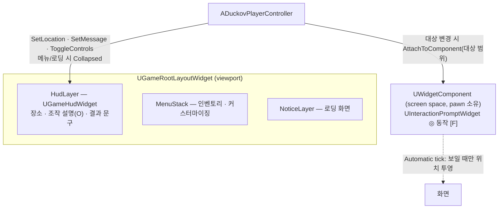

# 설계결정기록 025 — HUD layer와 물체에 붙는 상호작용 프롬프트

| 항목 | 내용 |
| --- | --- |
| 상태 | Accepted |
| 날짜 | 2026-10-14 |
| 작업 범위 | M3 / UI 구조 개편 1단계 — 베이스먼트·레이드 HUD |
| Risk | LOW — 표시 widget과 root layout layer 추가, controller 연결 변경. Model·저장 형식·공개 API 변경 없음 |
| 판단 주체 | AI(위임 범위). 화면 순서(HUD → 인벤토리 → 커스터마이징)와 원작 관찰은 사용자 지시 |
| 사용자 검토 | 미검토 |
| 관련 | CommonUI root layout과 Menu stack(021), 월드 오브젝트 상호작용(024), `docs/DUCKOV_UI_REFERENCE.md`의 HUD 관찰 |

## Context / Decision Question

024의 프롬프트는 화면 아래 중앙에 고정된 pill이었고, 결과 문구도 같은 widget이 Notice layer에서 보였다.
원작(2026-10-14 관찰)은 프롬프트를 물체의 ◎ 자리에 붙이고, 장소·조작 설명 같은 HUD를 화면 모서리에 둔다.
이 게임에서 동작하는 요소만 원작 배치로 옮기면서, HUD를 root layout의 어디에 둘지와
매 프레임 위치가 바뀌는 프롬프트를 상시 Tick 없이 어떻게 갱신할지 정한다.

## Decision / Rationale

- **root layout에 HUD layer 추가(HUD → Menu stack → Notice 순)**: HUD는 열린 메뉴 아래에 깔리는 표시이므로 Notice layer가 아니라
  Menu stack 아래에 둔다. 021과 같은 이유로 activatable root로 두지 않아 CommonUI 입력 경쟁에 참여하지 않는다.
- **`UGameHudWidget`**: 왼쪽 아래 장소 pill(기지/레이드 구역), 오른쪽 위 "조작 설명 [O]"와 O로 펼치는 키 목록,
  아래 중앙 결과 문구. 값이 바뀔 때만 controller가 갱신하고 Tick이 없다. 원작처럼 메뉴나 로딩 화면이 열리면 감춘다.
  장소 이름은 두 맵이 같은 GameMode를 쓰므로 맵 이름으로 정한다.
- **프롬프트는 screen space `UWidgetComponent` 하나**: 상호작용 대상이 바뀌면 그 범위 component에 옮겨 붙인다(◎는 물체 중심 60 cm 위).
  카메라가 따라 움직여 화면 위치가 계속 바뀌므로 위치 투영은 매 프레임 필요하다. 투영은 엔진의 screen layer(`SWorldWidgetScreenLayer`)가
  Slate tick에서 하고, component tick은 widget을 그 층에 넣고 빼기만 한다. `ETickMode::Automatic`은 widget이 보일 때만 component를 tick하므로
  대상이 없으면 tick 비용이 없다.
- **component 소유자는 빙의한 pawn**: screen space widget은 소유 actor가 숨겨져 있으면 그려지지 않는다(엔진 `WidgetComponent.cpp`의
  `!GetOwner()->IsHidden()` 조건). PlayerController는 숨은 actor라서 처음 구현에서는 논리 상태는 맞는데 화면에 보이지 않았다.
- **숨길 때 widget 자체를 감춘다**: 처음에는 component만 숨기고 tick을 직접 꺼서, screen layer에서 빠지지 못한 widget이 메뉴 뒤에 비쳤다.
  Automatic mode에서는 component만 숨겨도 다음 tick에 층에서 빠지지만, widget이 보이는 상태로 남아 tick이 계속 돈다.
  widget을 Collapsed로 두어야 Automatic mode가 tick을 끈다.
- **만들지 않은 원작 요소**: 시계·폭풍 카운트다운·체력·물/에너지·무기·퀵슬롯·조준 거리·물체마다 늘 보이는 ◎.
  이 게임에 기능이 없거나(앞의 것들), 물체마다 widget을 상시 그려야 한다(◎).

## Alternatives / Trade-offs

- **controller가 대상 위치를 직접 투영해 HUD 안의 widget을 옮기기**: widget component 없이 layout 안에서 끝난다.
  대신 매 프레임 투영할 Tick이나 timer를 직접 관리해야 하고, 엔진이 이미 제공하는 "보일 때만 tick"을 다시 만드는 셈이다.
- **상호작용 물체마다 widget component를 두기**: 원작처럼 모든 물체에 ◎를 늘 보일 수 있다. 물체 수만큼 widget이 상시 그려지고 tick된다.
- **HUD를 Notice layer에 두기(024의 방식)**: layer를 늘리지 않는다. 하지만 메뉴 위에 그려지는 층이라 HUD의 의미와 맞지 않고,
  메뉴가 열릴 때마다 감추는 일을 빠뜨리면 메뉴 위로 HUD가 보인다.

## Consequences / Accepted Costs

- 프롬프트가 보이는 동안에는 component tick 하나와 screen layer의 위치 투영이 매 프레임 돈다. 대상이 없으면 둘 다 없다.
- 프롬프트 component의 수명이 pawn을 따른다. 빙의할 때 만들고 빙의를 풀거나 controller가 끝날 때 파괴한다.
- 024의 `UInteractionPromptWidget`은 pill만 남았고, 결과 문구는 HUD로 옮겼다.
- 기본 글꼴의 한글은 Bold가 없어 원작보다 가볍게 보인다. 글꼴은 이번 범위 밖이다.
- 전체 회귀에서 첫 프레임 정지로 생기는 기존 `CharacterMovement` 반복 한도 경고가 실행마다 다른 테스트에서 나타났다. 결과에는 영향이 없다.

## Revisit Conditions

- 체력·탄약·퀵슬롯 같은 게임 시스템이 생길 때: 원작의 아래 중앙 묶음을 HUD에 추가한다.
- 상호작용 물체가 많아져 발견하기 어려울 때: 상시 ◎ 표시를 가벼운 방식(공유 widget, material billboard 등)으로 검토한다.
- 맵이 늘어나 장소 이름을 맵 이름으로 정하기 어려울 때: 장소 이름을 맵 데이터로 옮긴다.

## Verification

2026-10-14 실행 결과. 증거는 `Saved/Automation/Hud/`, `Saved/Logs/Hud*.log`에 있다.

- Editor, Game Win64 Development, Editor `-DisableAdaptiveUnity` 빌드: 각각 `Result: Succeeded`.
- 새 process 전체 Automation(`-nocefaccelpaint`): **101 succeeded + 1 succeededWithWarnings / 0 failed / 0 notRun**(`Final3`), 102개 경로 누락 0.
  `Duckov.Raid.LoopFromBasement`에 추가한 검사: 시작 시 HUD 표시와 장소 "기지", 대상이 없으면 프롬프트 tick 꺼짐,
  실제 O 키로 조작 설명 펼침, 프롬프트가 현재 대상 범위에 붙고 소유 actor가 숨지 않음·widget 표시, 메뉴가 열리면 HUD와 프롬프트 widget 감춤,
  닫으면 둘 다 복귀, 로딩 중 프롬프트 widget 감춤, 레이드 장소 "레이드 구역". 결과 문구 검사는 HUD의 문구로 옮겼다.
- 독립 실행(`-game`, 1280×720)에서 AI가 띄운 창에만 키 메시지를 보내 캡처했다: 시작 HUD, O 목록, 창고 위 프롬프트, 메뉴 뒤 감춤, 범위 밖 사라짐.
- 실패 기록
  - 처음에는 controller가 프롬프트 component를 소유해 테스트는 통과했지만 화면에 그려지지 않았다(독립 실행 캡처로 발견). 소유자를 pawn으로 바꾸고 테스트에 소유 actor 표시 검사를 넣었다.
  - 메뉴를 열면 프롬프트가 메뉴 뒤에 비쳤다(캡처로 발견). widget 자체를 감추고 테스트에 widget 표시 검사를 넣었다.
  - tick을 직접 끄던 방식은 pawn의 BeginPlay가 widget component의 tick을 다시 켜서 전체 회귀 2회에서 실패했다(`Final`, `Final2`).
    엔진의 Automatic tick mode로 바꿨다.
- 독립 검토: 별도 문맥의 cpp-reviewer가 PASS, LOW 3건을 모두 반영했다 — 위치 투영 주체와 widget을 감추는 이유의 서술 정정(위 Decision),
  `NewObject`의 고정 이름 제거(파괴 직후 같은 pawn 재빙의 시 garbage 객체 재사용 방지), HUD 감춤이 프롬프트 component 유무에 묶이지 않게 guard 분리.
  reviewer는 build·runtime을 실행하지 않았고 반영분은 재검토받지 않았다.
- 반영 뒤 최종 tree: 세 빌드 `Result: Succeeded`, 전체 Automation **100 succeeded + 2 succeededWithWarnings / 0 failed / 0 notRun**(`Final4`), 102개 경로.
  경고 2건은 모두 기존 `CharacterMovement` 반복 한도 로그다.
- 미검증: 사람의 직접 조작, 게임패드, 해상도·DPI별 배치, 패키징·Shipping.
