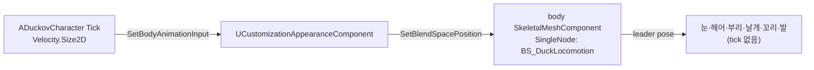

# 설계결정기록 034 — 플레이어 걷기 애니메이션: 발 bone, BlendSpace, body leader pose

| 항목 | 내용 |
| --- | --- |
| 상태 | Accepted |
| 날짜 | 2026-10-18 |
| 작업 범위 | M3 / 지상 캐릭터 디테일 — Idle·Walk 애니메이션 |
| Risk | LOW — 로컬 에셋·게임 모듈 변경이고 저장 포맷·네트워크·외부 API가 없다. 공통 Skeleton과 외형 컴포넌트를 바꿔 영향 범위가 넓으므로 독립 검토를 둔다 |
| 판단 주체 | 목표·동작은 사용자 지시("idle상태와 걷는 애니메이션을 구현해서 넣고싶어")와 Blender 미리보기 수용("이 동작으로 좋아"). bone 구성·재생 구조·테스트는 AI(위임 범위) |
| 사용자 검토 | Blender 미리보기 GIF 수용, 게임 PIE 확인(2026-10-18, "PIE 확인했어"). 사용자 보고이며 AI 직접 관찰 아님 |
| 관련 | [023 지상 캐릭터](023-ground-character-and-basement.md)의 재검토 조건("animation 에셋이 생길 때 `SetForceRefPose`를 풀고 animation 경로를 붙인다")을 이행한다. [029 슬롯 일괄 교체](029-customization-slot-batch-replace.md)·[033 고정 몸통](033-customization-fixed-body-part-types.md)의 계약은 유지한다 |

## Context / Decision Question

지상 캐릭터는 reference pose 그대로 미끄러지듯 이동했다(023). 외형은 고정 몸통 body와 부위 6개가 각각 별도 skeletal mesh component이고,
모두 tick 없이 reference pose만 평가한다(029·033). 발은 `root` bone에 weight 1이라 걸음을 표현할 수 없었다.
커스터마이징 미리보기의 pixel 비교와 "검증 후 한 번에 공개" 계약을 깨지 않고 게임 캐릭터만 움직이게 해야 한다.

## Decision / Rationale

- **발 bone 2개**: 공통 rig에 `foot_l`/`foot_r`(부모 root, 발목)를 더해 7 bones로 만든다. body와 발 mesh 2종만 다시 import하고,
  발 mesh만 발 bone에 skin한다. 다른 부위 mesh는 5 bones 그대로 같은 Skeleton을 쓴다(Skeleton은 bone을 merge했다).
- **애니메이션 2개 + BlendSpace1D**: `A_DuckIdle`(2초)·`A_DuckWalk`(16 frame, 두 걸음)는 Blender에서 제작한 제자리 루프다(`author_animation.py`).
  `BS_DuckLocomotion`은 Speed 축 0=Idle, 350(걷기)=Walk, 600(달리기)=Walk×1.71 재생 속도이고 입력 smoothing 0.15초다.
  AnimBlueprint 없이 `UAnimSingleNodeInstance`로 재생한다.
- **body만 재생, 부위는 leader pose**: `UCustomizationAppearanceComponent::SetBodyAnimation()`으로 opt-in한다. 지정하면 새로 준비하는 body가 tick하며 BlendSpace를 재생하고,
  공개 시점에 모든 skeletal 부위를 `SetLeaderPoseComponent(body)`로 묶는다. body가 바뀌면 재사용 부위도 새 body로 다시 묶은 뒤 이전 body를 없앤다.
  지정하지 않으면(커스터마이징 미리보기) 지금처럼 tick 없는 reference pose다.
- **실패 계약 유지**: body 애니메이션의 Skeleton이 body mesh와 다르면 표시를 바꾸기 전에 `SkeletonMismatch`로 실패한다.
  재생 상태(애니메이션 asset·tick 설정·ref pose 여부)도 "이미 같은 외형" 판정에 넣어 같은 Profile 재적용은 아무것도 바꾸지 않는다.
- **입력**: `ADuckovCharacter`가 actor tick에서 수평 속도를 `SetBodyAnimationInput()`으로 넘긴다. 새로 준비되는 body도 마지막 입력으로 시작한다.

## Alternatives / Trade-offs

- **AnimBlueprint**: 상태 머신·전환 규칙을 에디터에서 다루기 좋다. 하지만 graph를 스크립트로 만들고 검증하기 어렵고, 지금은 BlendSpace 하나로 충분하다.
- **발 bone 없이 5 bones 유지**: Skeleton과 mesh를 건드리지 않는다. 몸 기울기·날개만 움직이고 발은 고정이라 "걷는" 느낌이 약해 버렸다.
- **부위마다 같은 애니메이션 재생**: leader pose가 필요 없다. 부위가 나중에 교체되면 재생 시점이 어긋나고 tick이 부위 수만큼 늘어 버렸다.
- **캐릭터가 적용 뒤 component를 직접 바꾸기**: 외형 컴포넌트를 건드리지 않는다. 대신 "같은 외형" 판정이 깨져 확정 Profile 통지마다 전체를 다시 만들게 되어 버렸다.

## Consequences / Accepted Costs

- 게임 캐릭터는 actor tick 1개와 body component tick 1개를 쓴다. 부위 component는 여전히 tick하지 않는다. 인벤토리 UI의 상시 Tick 0 기준과는 무관하다.
- body·발 FBX의 기준 원본은 `CharacterAnimation.blend`다. `author_parts.py -- export`를 다시 돌리면 5 bones로 되돌아가므로 원본 README에 적었다.
- 공통 Skeleton이 7 bones가 되어 `CustomizationAssets.Verify`의 bone 수 기대를 body·발 7개로 바꿨다(앞 5개 공통 bone 검사는 유지).
- 게임 world에서 component tick 등록은 owner의 BeginPlay를 따른다. 준비 단계는 "tick 가능 설정"만 확인하고 실제 tick은 PIE 테스트가 확인한다.
- BlendSpace는 Python에서 sample을 넣을 수 없어 Editor Automation(`CharacterAnimationAssets.Create`)으로 만든다. 축·sample은 protected라 reflection으로 설정한다.
- UE 5.7 FBX 애니메이션 import는 mesh와 같은 축 옵션이어도 애니메이션 전체를 reference pose보다 yaw +90° 돌려 놓는다.
  `author_animation.py`가 애니메이션 FBX를 내보낼 때만 root bone 키에 반대 회전(`ANIMATION_EXPORT_YAW`)을 넣는다. 원본 action은 그대로다.
- 발 미끄러짐(foot sliding)은 감수한다. 걷기 속도 350 cm/s에 보폭 ±9 cm라 정확한 접지가 아닌 만화식 표현이다.

## Revisit Conditions

- 사격·조준·피격 등 상체 동작이 생길 때: 레이어 블렌딩·montage가 필요해지면 AnimBlueprint로 옮긴다.
- 방향 전환·정지 동작(start/stop)을 따로 넣을 때.
- 커스터마이징 미리보기에도 Idle을 넣을 때: pixel 비교 테스트의 기준을 함께 다시 정한다.
- 부위 mesh가 발 bone을 써야 할 때(예: 장비 신발): 해당 mesh를 7 bones로 다시 export한다.

## Verification

2026-10-18 실행 결과. 증거는 `Saved/Automation/CharacterAnimation/`에 있다.

- Blender `author_animation.py create`: bone 계층·발 weight 분리·루프 이음매(위치 2e-15 cm, 회전 0)·지면 관통 없음·FBX 왕복 bone 오차 1.4e-5 cm PASS.
- pilot UE `import_animation.py`: 공통 Skeleton 7 bones, Idle 2.0초/60 frame, Walk 0.533초/16 frame, Walk 0초에 왼발이 오른발보다 6.0 cm 높음(축 변환 확인) PASS.
  첫 실행은 mesh가 Interchange 경로로 들어가 버리고 legacy FbxFactory로 다시 실행했다(`PilotImport.log` → `PilotImport2.log`).
- Editor·Game 빌드 `Result: Succeeded`. 첫 Editor 빌드는 const·TestEqual 오버로드 오류로 실패해 고쳤다.
- `CharacterAnimationAssets.Create`(명시 실행) Success. 새 `CharacterAnimationAssets.Verify`, `Duckov.Customization.Skeletal.AnimatedBodyLeadsParts`,
  `Duckov.Basement.CharacterMovement`(애니메이션 재생·부위 추종·달리기 입력·정지 입력 검사 추가) 통과.
- 실패 기록: 처음 애니메이션 body가 `PreparationFailed`였다. 진단 로그로 등록 전 `SetAnimation`이 무시되고(instance 없음) 테스트 world에서 tick이 등록되지 않음을 확인해
  등록 뒤 `PlayAnimation`과 tick 가능 설정 검사로 고쳤다. 그 실행에서 PIE 테스트가 null body를 역참조해 에디터가 종료됐고 테스트를 null-safe로 고쳤다.
  `-nullrhi` 실행의 skeletal 테스트 실패는 render 자원이 없는 환경 탓이며 실제 RHI에서 통과했다.
- 전체 Automation(`Duckov.+InventoryAssets.Verify+CustomizationAssets.Verify+CustomizationCatalogAssets.Verify+CharacterAnimationAssets.Verify`, 실제 D3D12 RHI,
  `-nocefaccelpaint`) **130 succeeded / 0 failed**(`RunFull2.log`). 첫 전체 실행은 `CustomizationAssets.Verify`의 bone 수 5 기대 1건 실패로 위 계약을 갱신했다(`RunFull1.log`).
- 화면: standalone 게임 창을 AI가 W·Shift+D 입력으로 움직이고 캡처해 걷기·달리기 frame에서 몸 기울기·발 위치·날개가 바뀌고 부위가 body를 따라가는 것을 확인했다
  (`Visual/sheet.png`). 게임 로그에 외형 실패·애니메이션 경고 없음.
- 독립 검토: cpp-reviewer Approve, 구체적 결함 없음(정적 검토). 참고 사항은 M3 worklog에 남겼다.
- 사용자 PIE 확인(2026-10-18): "PIE 확인했어".
- 사후 결함(2026-10-18, 사용자 PIE 보고 "플레이어의 측면을 정면으로 인식하고 있어"): 마우스 조준을 넣자 재생 중 외형이 옆을 보는 것이 드러났다.
  mesh·reference pose는 +X 정면이었고, import한 애니메이션 두 개의 root가 yaw +90° 돌아가 있었다. 이전 검사는 발 높이 차와 component 축만 봐서 놓쳤다.
  Force Front X 끄기·body mesh 함께 내보내기·armature object 회전은 효과가 없었고, 내보낼 때 root bone 키에 회전을 넣어 Idle 첫 frame이 reference pose와
  위치 0 cm·회전 0°로 일치했다. `import_animation.py`의 첫 frame 비교, `CharacterAnimationAssets.Verify`의 root·body 방향, 재생 중 왼쪽 날개 위치 검사
  (`AnimatedBodyLeadsParts`, `Basement.CharacterMovement`)를 더했고, 세 검사가 이전 에셋에서 실패하는 것을 확인했다(`AxisNegative.log`). 수정 뒤 전체 131개 통과(`AxisRunFull1.log`).
- 미검증: 게임패드(범위 밖), 패키징 cook 포함 여부(BlendSpace는 문자열 경로로 로드한다).
