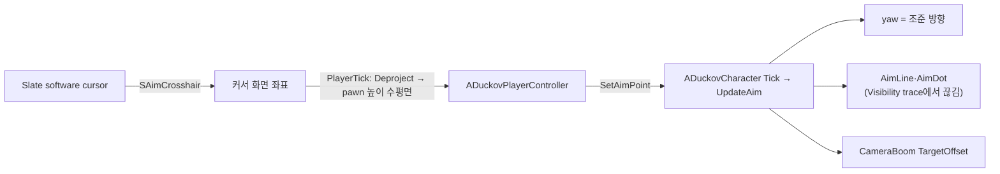

# 설계결정기록 035 — 마우스 조준: 커서를 바라보는 회전, 십자선, 카메라 앞당김, 레이저 사이트 선

| 항목 | 내용 |
| --- | --- |
| 상태 | Accepted |
| 날짜 | 2026-10-18 |
| 작업 범위 | M3 / 지상 캐릭터 디테일 — 마우스 회전·조준 |
| Risk | LOW — 게임 모듈의 입력·카메라·표시 변경이다. 저장·네트워크·외부 API가 없고 메뉴 입력 흐름(CommonUI)은 기존 경로를 쓴다 |
| 판단 주체 | 목표는 사용자 지시("플레이어 로테이션은 원작처럼 마우스로 … 조준도 마우스로"). 원작 동작은 AI가 Computer Use로 관찰(`docs/DUCKOV_UI_REFERENCE.md`의 "마우스 회전·조준"). 구조·수치·테스트는 AI(위임 범위) |
| 사용자 검토 | 사용자 PIE 확인(2026-10-18, "PIE 확인했어"). 사용자 보고이며 AI 직접 관찰 아님 |
| 관련 | [023 지상 캐릭터](023-ground-character-and-basement.md)의 재검토 조건("사격·조준을 넣을 때: 마우스 위치 기반 회전, 조준선, 카메라 look-ahead를 추가하고 커서·mouse capture 설정을 다시 정한다")을 이행한다. [021 CommonUI layer](021-commonui-layer-stack.md)의 메뉴 입력 전환은 그대로다 |

## Context / Decision Question

캐릭터는 이동 방향을 바라봤고(`bOrientRotationToMovement`), 게임 입력은 커서를 숨긴 `CapturePermanently`였다.
원작은 이동과 무관하게 항상 커서 쪽을 바라보고, 커서 자리에 십자선, 몸에서 커서까지 막히면 끊기는 노란 조준선이 있으며, 카메라가 커서 쪽으로 앞서 간다.
사격·RMB 조준 동작은 아직 없다.

## Decision / Rationale

- **조준 지점은 controller가 정하고 캐릭터가 쓴다**: `ADuckovPlayerController::PlayerTick`이 메뉴가 닫혀 있을 때 커서 화면 좌표를
  pawn 높이의 수평면에 투영해(`ScreenToAimPoint`) `ADuckovCharacter::SetAimPoint`로 넘긴다. 입력→pawn 방향은 이동 입력과 같다.
  메뉴가 열려 있거나 커서가 viewport 밖이면 마지막 조준을 유지한다.
- **회전·조준선·카메라는 캐릭터 tick의 `UpdateAim`**: 조준 지점 쪽으로 즉시 yaw를 맞추고(`bOrientRotationToMovement=false`),
  레이저 사이트가 켜져 있으면 몸 가장자리에서 조준 지점까지 Visibility trace를 해 막히면 그 지점에서 선과 끝 점을 끊는다.
  원작에서 이 선은 총기에 레이저 사이트를 달아야 보이므로(사용자 설명) `SetLaserSightEnabled`로 켜는 부가 기능이고 기본은 꺼져 있다.
  꺼져 있으면 trace도 하지 않는다. 아직 이를 켜는 장비가 없다. spring arm `TargetOffset`을
  조준 방향 × 0.15(최대 300 cm)로 두어 기존 camera lag가 부드럽게 따라가게 한다. 0.15는 원작 관찰(커서를 화면 끝에 두면 캐릭터가 창 너비의 약 7% 밀림)에 맞춘 값이다.
- **십자선은 software cursor**: `SAimCrosshair`(Slate leaf widget)를 viewport의 `Crosshairs` cursor로 등록한다. Slate가 커서 위치 중앙에 그리므로 위치를 갱신하는 tick이 없다.
- **게임 입력은 커서 표시 + `CaptureDuringMouseDown`**: CommonUI의 `CapturePermanently`는 커서를 보여도 high precision 마우스를 켜 커서를 묶는다.
  커서 위치를 읽어야 하므로 누르는 동안만 capture한다. 처음 게임 입력도 같은 `RestoreGameInput` 경로로 정한다.
  Router는 local player에 남아 맵을 넘어도 같은 설정을 다시 적용하지 않으므로 커서 표시는 controller가 직접 켠다.
- **커서가 몸 안쪽이면 돌지 않는다**: 방향이 흔들리지 않게 회전을 유지하고 조준선을 숨긴다.

## Alternatives / Trade-offs

- **화면 좌표 대신 커서 아래 바닥으로 line trace**: 상자 위를 가리키면 조준 지점이 위로 튄다. 수평면 투영은 지형에 무관하고 회전에는 수평 방향만 필요하다.
- **UMG 십자선 위젯을 HUD에 두고 매 frame 위치 갱신**: 위치 갱신 tick이 생긴다. software cursor는 Slate의 커서 그리기에 얹혀 추가 갱신이 없다.
- **OS `Crosshairs` 커서 그대로**: 코드가 거의 없지만 원작의 4방향 눈금 모양과 다르고 플랫폼마다 모양이 다르다.
- **회전을 부드럽게 보간**: 원작은 커서를 따라 즉시 돌았다. 즉시 회전이 조준선과 커서의 일치도 보장한다.

## Consequences / Accepted Costs

- 게임 중 커서가 보이고 창 밖으로 나갈 수 있다(창 모드). 창 밖이면 마지막 조준을 유지한다.
- 매 frame controller의 투영 1회가 들고, 레이저 사이트가 켜져 있으면 line trace 1회가 더 든다. 캐릭터 1명이라 무시할 수 있다.
- 걷기 애니메이션은 몸 방향 기준이라 커서 반대로 걸으면 앞으로 걷는 동작이 그대로 나온다(뒷걸음 전용 동작 없음).
- 게임 시작 뒤 마우스를 한 번도 움직이지 않으면 조준 지점이 없어 조준선이 없고 회전도 처음 방향이다.
- 조준선 material은 엔진 `BasicShapeMaterial`(lit)의 MID라 조명에 따라 밝기가 바뀐다.
- `Duckov.Basement.CharacterMovement`의 "진행 방향을 바라봄" 검사는 "이동 중에도 조준 지점을 바라봄"으로 바뀌었다.

## Revisit Conditions

- 무기 부착물(레이저 사이트)을 장비로 만들 때: 장착 상태에서 `SetLaserSightEnabled`를 부르게 잇는다.
- 사격·RMB 조준을 넣을 때: 원작의 RMB 누름 조준 효과(이동 속도·카메라 거리·조준선 변화)를 관찰해 이 구조에 더하고, 총구 위치에서 선을 시작한다.
- 게임패드를 지원할 때: 오른쪽 stick 조준 입력을 조준 지점의 다른 출처로 더한다(현재 범위 밖).
- 2층 구조나 경사가 생겨 수평면 투영이 맞지 않을 때.

## Verification

2026-10-18 실행 결과. 증거는 `Saved/Automation/CharacterAnimation/`에 있다.

- Editor(일반·`-DisableAdaptiveUnity`)·Game 빌드 `Result: Succeeded`. 첫 빌드는 지역 변수가 controller 멤버 `Character`를 가린 오류와,
  직전 커밋의 `CharacterAnimationAssetsTests.cpp` 파일 범위 `using namespace`가 unity 묶음에서 다른 테스트의 `Flags`와 충돌한 오류로 실패해 고쳤다.
- 새 `Duckov.Character.MouseAim`(회전·조준선 길이·벽에서 끊김·카메라 앞당김·최대 거리·몸 안쪽 커서), `Duckov.Basement.CharacterMovement`(보이는 십자선 커서,
  화면 좌표↔조준 지점 왕복 1 px 이내, 이동 중 조준 지점 바라봄) 통과.
- 전체 Automation(실제 D3D12 RHI, `-nocefaccelpaint`) **131 succeeded / 0 failed**(`AimRunFull1.log`, 비율 조정 뒤 `AimRunFull2.log`, 리뷰 반영 뒤 `AimRunFull3.log`).
- 독립 검토: cpp-reviewer가 맵 이동 뒤 커서가 숨는 결함(HIGH)을 찾았다. `Duckov.Raid.LoopFromBasement`의 새 커서 검사로 수정 전 실패를 재현하고 고쳤으며 재검토 PASS.
- 화면: standalone 게임에서 AI가 실제 커서를 네 방향으로 옮기고 W로 걸으며 캡처했다(`AimVisual/`, `AimVisual2/`). 커서 방향 회전, 상자에서 끊기는 조준선,
  조준선 끝 점과 십자선 중심 일치, 위로 걸으면서 오른쪽 커서 바라보기를 확인했다. 앞당김 0.3에서 캐릭터가 약 15% 밀려 0.15로 줄였다(약 6%).
- 사용자 PIE 피드백(2026-10-18): "조준점까지의 lay가 보이잖아. 이건 원작에서 총기에 레이저 사이트가 부착 되어야만 보이는 lay 선이야".
  선을 기본 꺼짐 옵션으로 바꾸고 `Duckov.Character.MouseAim`에 기본 없음·켜기·끄기를 검사했다. 전체 131개 통과(`LaserRunFull1.log`), 화면에서 십자선만 보임(`LaserVisual/`).
- 사용자 PIE 확인(2026-10-18): "PIE 확인했어".
- 미검증: RMB 누름 조준(원작 관찰도 못 함), 레이저 사이트를 켠 상태의 사용자 확인, 게임패드(범위 밖).
