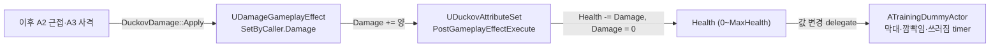

# 설계결정기록 038 — 기본 공격의 피해 경로: GAS Damage meta attribute와 과녁 dummy

| 항목 | 내용 |
| --- | --- |
| 상태 | Accepted |
| 날짜 | 2026-11-13 |
| 작업 범위 | M3 / 기본 공격 A1 — 피해를 받는 과녁, A2 — 맨손 근접 공격, A3 — 총 사격, A4 — 재장전과 탄약 HUD(아래 절) |
| Risk | LOW — 게임 모듈에 GAS 의존과 새 actor를 더하고, 베이스먼트·레이드 맵에 과녁 하나씩을 놓는다. 기존 API·저장 레코드 v1·InventoryCore는 바꾸지 않는다 |
| 판단 주체 | 사용자: GAS 착수 전에 기본 공격을 먼저 기획, 형태는 "사격 + 맨손 근접", 탄약은 "Ammo 소모 + R 재장전", 대상은 "과녁 dummy", GAS 관계는 "피해만 GAS GE로", 진행은 "A1부터 시작". attribute 구성·GE 구조·과녁 동작·배치·수치·테스트는 AI(위임 범위) |
| 사용자 검토 | 미검토 |
| 관련 | GDD 기술 방침 "GAS를 최소 범위로 사용". [032 무기·방어구 slot](032-weapon-armor-equipment-slots.md)의 "장비 효과(GAS)" 재검토 조건의 선행 작업. [035 마우스 조준](035-mouse-aim-rotation.md)의 조준 지점을 이후 사격(A3)이 쓴다 |

## Context / Decision Question

GAS 플러그인은 켜져 있었지만 게임 모듈 의존도, 체력·피해를 가진 대상도 없었다. 사용자는 장비 효과(GAS)에 앞서 기본 공격을 기획하기로 했고,
기본 공격은 A1 과녁 → A2 맨손 근접 → A3 소총 사격 → A4 재장전·탄약 HUD 순서로 나눴다.
A1은 공격 입력 없이 "피해가 어디를 지나 체력을 줄이는가"와 "맞출 대상"을 정한다. 이후 근접·사격·방어구 감산이 모두 이 경로에 붙는다.

## Decision / Rationale

- **피해는 meta attribute `Damage` 한 곳을 지난다**: `UDuckovAttributeSet`은 `Health`·`MaxHealth`·`Damage`를 가진다.
  피해 GE(`UDamageGameplayEffect`, Instant)는 `Damage`에 SetByCaller(`SetByCaller.Damage`) 값을 더하고,
  `PostGameplayEffectExecute`가 그 값을 `Health`에서 빼고 `Damage`를 0으로 되돌린다. `Health`는 base·current 모두 0~`MaxHealth`로 clamp한다.
  음수 피해로는 회복하지 않는다. 공격 방식과 무관하게 `DuckovDamage::Apply(대상, 양, 공격자)` 하나를 부른다.
- **발사·재장전은 GAS 밖(일반 C++)에 둔다(사용자 선택)**: GDD의 "GAS 최소 범위"에 맞춰 GameplayAbility·cooldown tag는 쓰지 않는다. A1에서는 피해 GE와 attribute만 생긴다.
- **GE는 C++ class 하나**: 생성자(CDO)에서 modifier를 구성한다. native tag는 정적 초기화 때 이름이 정해져 CDO 생성 시점에 쓸 수 있다.
  데이터 에셋(Blueprint GE)을 만들지 않아 cook 대상과 에셋 생성 명령이 늘지 않는다.
- **과녁 `ATrainingDummyActor`**: ability system component와 attribute set subobject를 가진 기둥이다(지름 60 cm, 키 160 cm, 최대 체력 100).
  체력 변경 delegate 하나로 체력 막대(머리 위에 눕힌 판, 화면 가로 방향 yaw 50°)를 고치고, 줄었으면 0.1초 밝게 깜빡인다.
  0이 되면 옆으로 눕고(충돌 끔, 막대 감춤) 3초 뒤 최대 체력으로 다시 선다. 쓰러진 동안 받은 피해는 체력도 다시 서는 시각도 바꾸지 않는다. Tick은 없다.
- **배치는 맵 생성 명령과 추가 명령**: `BasementAssets.Create`·`RaidAssets.Create`가 과녁을 함께 놓고, 이미 있는 맵에는
  `TrainingDummyAssets.AddToMaps`가 하나만 더한다(있으면 저장하지 않음). 위치는 시작 지점에서 보이고 창고·출격·탈출 지점과 loot로 가는 길을 벗어난 곳이다.
  베이스먼트 (-600, 450), 레이드 (-400, -1100).

## Alternatives / Trade-offs

- **GE가 `Health`를 직접 깎음**: 클래스가 하나 줄지만, 방어구 감산(G1/G3)을 넣을 때 피해를 주는 곳마다 계산을 넣거나 GE를 다시 짜야 한다. meta attribute는 감산 지점을 하나로 둔다.
- **GAS 없이 과녁에 float 체력**: 가장 빠르지만 GAS를 넣을 때 피해 경로를 다시 만든다. 사용자가 "피해만 GAS GE로"를 골랐다.
- **체력 막대를 UMG `UWidgetComponent`로**: 글자·모양을 꾸미기 쉽지만 component가 매 frame 그려 상시 갱신 비용이 생긴다. 판 두 개(static mesh)는 체력이 바뀔 때만 크기를 바꾼다.
- **과녁을 GameMode가 BeginPlay에 생성**: 맵 에셋을 바꾸지 않지만 맵을 열어도 과녁이 안 보이고 위치가 코드에 숨는다. 다른 상호작용 지점처럼 맵에 놓았다.

## Consequences / Accepted Costs

- `DuckovLike`가 `GameplayAbilities`·`GameplayTags`·`GameplayTasks`에 의존한다. `InventoryCore`는 GAS를 모른다.
- 과녁의 ability system은 replication 설정을 두지 않는다(싱글플레이, 의도적 제외 범위).
- 체력 막대 방향은 지상 카메라 yaw(-40°)를 상수로 복제했다. 카메라 각도를 바꾸면 함께 바꿔야 한다.
- 피해량 표시(숫자 popup)와 피격 소리는 없다. 깜빡임과 막대만으로 피격을 알린다.
- 테스트 world에서 timer를 진행하려면 frame 번호를 올리고, 첫 tick을 미리 돌려야 한다(`FTimerManager`는 frame당 한 번만 tick하고, 첫 tick 전에 건 timer는 pending으로 한 tick 늦게 시작한다).

## Revisit Conditions

- 방어구 효과(G1)를 넣을 때: 감산 위치(`PostGameplayEffectExecute` 또는 ExecutionCalculation)와 플레이어 ability system 소유자를 정한다.
- 적 AI·위험 구역처럼 플레이어가 피해를 받을 때: 플레이어 체력 HUD와 사망 처리(GDD P1 장비 손실)를 정한다.
- 피해 종류(관통·폭발)나 피격 반응이 늘 때: GameplayCue나 피해 tag를 검토한다.

## Verification

2026-11-13 실행 결과. 증거는 `Saved/Automation/Combat/`에 있다.

- Editor·Game Win64 Development 빌드: 각각 `Result: Succeeded`(`Build3.log`, `GameBuild1.log`).
- 새 테스트 `Duckov.Combat.TrainingDummy`(BeginPlay와 timer가 도는 transient world): 시작 체력·막대, 피해 30 → 체력 70·Damage 0·막대 70%·깜빡임과 그 종료,
  0·음수 피해와 ability system 없는 대상 거부, 큰 피해의 0 clamp·쓰러짐(충돌·막대), 쓰러진 동안 피해 무시와 다시 서는 시각 유지, 복구 뒤 피해. 첫 두 실행은 테스트의 timer 진행 방식 때문에 실패했고 helper를 고쳐 통과(`Targeted1~3.log`).
- `TrainingDummyAssets.AddToMaps`: 원본 맵을 `*-before.umap`으로 복사한 뒤 실행해 성공(`AddToMaps.log`). 재실행은 저장하지 않았고 두 맵의 hash가 같았다(`Targeted1.log`).
  `Duckov.Basement.Assets`·`Duckov.Raid.Assets`에 과녁 하나 검사를 더해 통과.
- 전체 회귀(`Duckov.+InventoryAssets.Verify+CustomizationAssets.Verify+CustomizationCatalogAssets.Verify+CharacterAnimationAssets.Verify`, 실제 D3D12 RHI, `-nocefaccelpaint`):
  **134개 / 실패 0**(128 succeeded + 6 succeededWithWarnings, `RunFull1.log`) = 이전 133개 + 새 1개. AI의 실행 명령이 `shell_guard` 훅에 막혀 사용자가 같은 명령을 직접 실행했다.
  - 새 경고 2건은 이번 변경 때문이었다. GameplayCue 경로 미설정(`Duckov.Basement.Assets`, GAS 첫 초기화)과 테스트 world의 EndPlay 누락(`Duckov.Combat.TrainingDummy`).
    `DefaultGame.ini`에 `GameplayCueNotifyPaths=/Game/GameplayCues`(쓰지 않는 폴더)를 두고, 테스트가 world를 닫기 전에 `EndPlay`를 부르게 고쳤다.
  - 나머지 4건은 캐릭터 이동 시뮬레이션 단계 로그(`CharacterMovement`·`Raid.FullInventory`·`UI.EquipmentSlots`)와 기존 `Character.MouseAim`의 world context 로그다. `UI.EquipmentSlots`는 이번에 처음 같은 종류의 이동 로그가 붙었다(frame 지연에 따라 나타나는 기존 종류).
- 독립 검토(cpp-reviewer, fresh context): **PASS**, LOW 4건. 모두 반영했다 — `RecoverDelay` 하한(0 이하이면 timer가 등록되지 않음), 다시 설 때 쓰러지기 전 충돌 설정 복원,
  Build.cs 주석의 문서 인용을 제목으로, 테스트의 `GFrameCounter` 증가 이유 주석. 반영분 재검토는 not_run.
- 반영 뒤: Editor·Game 빌드 `Result: Succeeded`(`Build4.log`, `GameBuild2.log`), `Duckov.Combat`·`Duckov.Basement.Assets`·`Duckov.Raid.Assets` **3개 경고 없이 통과**(`Targeted4.log`, NullRHI).
  반영분은 과녁 class·테스트·ini 한 줄이라 전체 회귀는 다시 돌리지 않았다.
- 미검증: 화면에서 과녁·막대 모양(사용자 PIE), 공격 입력(A2 이후), 패키징 실행.

## A2 — 맨손 근접 공격 (2026-11-13 추가)

사용자는 A1 보고 뒤 PIE에서 "더미와 상호작용이 아무것도 안되는데?"라고 지적했고(A1은 공격 입력이 없었다), "A2 진행"을 지시했다. 판단 주체는 AI(위임 범위)다.

- **입력**: controller가 LMB를 `BindKey`로 받아 `Attack()`을 부른다. 다른 지상 키(I·F·O·L)와 같은 방식이다. 맵 이동 화면이나 메뉴가 열려 있으면 무시한다
  (CommonUI Menu 입력 모드는 game 입력을 이미 막지만, controller가 직접 확인해 호출 경로와 무관하게 막는다).
- **판정**: `ADuckovCharacter::TryMelee()`가 바라보는 방향(마우스 조준이 매 frame 정한 회전)으로 70 cm 앞을 중심으로 반지름 50 cm 구를 겹침 검사한다.
  object type `WorldDynamic`·`Pawn`, 자기 자신 제외, 같은 actor는 한 번만 친다. 맞은 actor마다 `DuckovDamage::Apply(대상, 15, 자신)`을 부르고,
  ability system이 없는 actor는 Apply가 거부한다. 과녁(체력 100)은 7번에 쓰러진다.
- **간격**: world 시간 기준 0.4초. 간격 안의 공격은 판정·표시 없이 `false`를 돌려준다. GameplayAbility·cooldown tag는 쓰지 않는다(A1의 "발사·재장전은 GAS 밖" 결정과 같다).
- **표시**: 공격 애니메이션이 없어 판정 원과 같은 크기의 흰 원판을 발 앞에 0.12초 보인다(timer 하나, Tick 없음). HUD 조작 설명에 "공격 LMB"를 더했다.

대안과 비용:

- **line trace(마우스 지점까지)**: 벽 너머를 맞히지 않지만 근접의 "앞쪽 범위"와 맞지 않고, 조준 지점이 멀면 근접이 원거리처럼 동작한다. 겹침 검사를 택한 대가로 얇은 벽 너머 50 cm 안의 대상도 맞는다.
- **Enhanced Input action 추가**: 이동·조준은 Enhanced Input이지만 지상 단발 키는 모두 `BindKey`라 같은 방식을 따랐다. 키 재설정이 필요해지면 함께 옮긴다.
- Rifle을 장착해도 근접 공격이 나간다. 무기 slot으로 사격과 나누는 것은 A3이다.
- 조준 방향이 1 frame 늦다. LMB 입력이 controller tick의 입력 처리에서 먼저 실행되고, 마우스 조준 회전은 그 뒤에 갱신된다. 근접에서는 허용하고,
  A3 사격에서 정확도가 문제되면 발사 직전에 현재 커서로 회전을 한 번 갱신한다.
- 판정은 구라서 바닥 높이의 단면이 원판보다 작다. 키 작은 대상이 생기면 원판 안인데 맞지 않을 수 있다(지금은 그런 대상이 없다).

검증(증거는 `Saved/Automation/Combat/`):

- Editor·Game 빌드 `Result: Succeeded`(`MeleeBuild4.log`, `MeleeGameBuild.log`). 첫 빌드는 열린 에디터의 Live Coding 때문에 실패했고, 사용자가 에디터를 닫은 뒤 통과했다.
- 새 테스트 `Duckov.Combat.Melee`(transient world): 앞 과녁만 피해, 뒤·먼 과녁 그대로, 간격 안 공격 거부, 판정 원 표시와 숨김, 돌아서면 뒤 과녁 적중.
- 새 테스트 `Duckov.Combat.MeleeInput`(베이스먼트 PIE): 실제 game viewport pointer 클릭으로 공격, 인벤토리가 열린 동안 차단, 맵에 놓인 과녁 적중.
  처음에는 LMB를 key 이벤트로 보내 시간 초과로 실패했다(마우스 버튼은 pointer 이벤트로 viewport에 들어간다). 인벤토리 drag 테스트와 같은 pointer 경로로 고쳤다.
  NullRHI에서는 기존 `Duckov.Basement.CharacterMovement`도 같은 입력 단계에서 실패해, PIE 입력 테스트는 실제 RHI로 확인했다(`MeleeInputRHI.log`, 둘 다 통과).
- 전체 회귀(A1과 같은 필터, 실제 D3D12 RHI, `-nocefaccelpaint`): **136개 / 실패 0**(134 succeeded + 2 succeededWithWarnings, `RunFull2.log`) = 134개 + 새 2개.
  경고 2건은 기존 종류(`CharacterMovement` 이동 시뮬레이션 단계 로그, `Character.MouseAim` world context 로그)다.
- 독립 검토(cpp-reviewer, fresh context): **PASS**, INFO 2·LOW 1. 조준 1 frame 지연과 구·원판 범위 차이는 위 비용으로 기록하고 원판 주석을 정확히 고쳤다.
  테스트 helper가 Slate hit-test를 거치지 않는다는 점(LOW)은 주석에 밝혔다. 주석만 바뀌어 Editor 빌드 `Result: Succeeded`(`MeleeBuild5.log`)만 다시 확인했다. 반영분 재검토는 not_run.
- 미검증: 사용자 PIE에서 공격 손맛·원판 표시·실제 클릭의 Slate hit-test 경로, 패키징 실행.

## A3 — 총 사격 (2026-11-16 추가)

사용자는 A2 보고 뒤 "A3 진행"을 지시했다. 기획 단계의 A3 정의(Rifle을 장착하면 사격, tracer, 잔탄 소모, 잔탄 0이면 "탄약이 없습니다", 벽에 막힘)를 따랐고,
아래 구조와 수치는 AI(위임 범위)가 정했다.

- **분기**: controller의 `Attack()`이 무기 slot(`WeaponSlot` 컨테이너)을 조회한다. 항목이 있으면 사격, 없으면 A2의 근접이다.
  slot에는 무기 종류 항목 하나만 들어가므로(장비 slot 등록 규칙) 항목 종류를 다시 확인하지 않는다. 지금 무기는 Rifle 하나다.
- **탄창은 세션이 소유한다**: `UGameSessionSubsystem`이 무기 InstanceId별 잔탄을 메모리에만 둔다. 저장 레코드 v1은 바꾸지 않는다(저장 포맷 변경은 HIGH).
  처음 묻는 무기는 가득 찬 탄창(20발)으로 시작한다. 재장전(A4)이 아직 없어 빈 탄창으로 시작하면 사격을 확인할 수 없기 때문이다. 해제·재장착·맵 이동에도 잔탄이 유지된다.
  캐릭터는 탄창을 모른다. controller가 잔탄을 확인하고, 캐릭터가 실제로 쐈을 때(`TryFire`가 true)만 한 발을 뺀다.
- **판정**: `ADuckovCharacter::TryFire()`가 몸 가장자리에서 바라보는 방향으로 3000 cm `ECC_Visibility` line trace를 쏜다. 처음 막은 것에서 멈추고,
  그것이 ability system을 가졌을 때만 피해 20을 준다(과녁은 5발에 쓰러진다). 간격 0.15초(단발, 누를 때마다 한 발).
- **조준 1 frame 지연 해소**: A2 검토에서 지적한 대로, 쏘기 직전에 controller가 지금 커서로 조준 지점을 갱신하고(`RefreshAimPoint`) 캐릭터가 그 방향으로 돈 뒤 쏜다.
  근접은 바꾸지 않았다.
- **표시**: 총알 선(tracer, 폭 3 cm, 연노랑)을 0.05초 보인다. 잔탄 0이면 HUD 아래 중앙 문구에 "탄약이 없습니다"를 띄운다. 잔탄 수 표시는 A4의 탄약 HUD에서 한다.

대안과 비용:

- **탄창을 아이템 인스턴스(Model)에 저장**: 저장·불러오기까지 자연스럽지만 `FItemInstance`와 저장 레코드가 바뀐다(HIGH). 세션 메모리는 게임을 끄면 잔탄이 가득 찬 상태로 돌아간다.
- **projectile actor**: 탄속·낙차를 낼 수 있지만 탄마다 actor·Tick이 생긴다. 탑다운 거리에서는 hitscan과 차이가 거의 없다.
- **object type 겹침(근접과 같은 방식)**: 벽을 통과한다. 사격은 보이는 것을 막는 채널로 쏴서 벽·상자에서 멈춘다. 총알을 막는 것은 벽·상자·엄폐물(StaticMeshActor), 창고 상자, 서 있는 과녁이다. loot·출격/탈출 원판·상호작용 범위·쓰러진 과녁은 통과한다.
- 탄창 크기·피해·간격은 캐릭터의 상수다. 무기 종류가 늘면 Definition 데이터로 옮긴다.
- "탄약이 없습니다" 문구는 기존 결과 문구처럼 상호작용 대상이 바뀌거나 맵을 옮길 때까지 남는다. 총을 해제하고 근접 공격을 해도 남는다. 지우는 시점은 A4(재장전·탄약 HUD)에서 정한다.
- 잔탄 표는 InstanceId로 찾는다. 지금은 세션당 Model을 한 번만 만들어 id가 재사용되지 않지만, 같은 세션에서 저장 레코드를 다시 Load하는 기능을 넣으면 이 표도 함께 비워야 한다.

검증(증거는 `Saved/Automation/Combat/`):

- Editor·Game 빌드 `Result: Succeeded`(`RifleBuild1.log`, `RifleGameBuild.log`).
- 새 테스트 `Duckov.Combat.Rifle`(transient world): 바라보는 방향의 과녁 적중과 tracer 끝(과녁 표면), 간격 안 사격 거부, tracer 숨김, 조준 지점 쪽으로 돌아 쏘기, 벽 뒤 과녁 미적중과 tracer가 벽 면에서 끝남, 빈 곳은 사거리 끝까지.
- 새 테스트 `Duckov.Combat.RifleInput`(베이스먼트 PIE): 소총을 무기 slot에 장착하면 LMB 함수가 사격(tracer)이 되고 근접은 나가지 않음, 처음 장착 탄창 20발과 한 발 소모, 빈 탄창은 쏘지 않고 "탄약이 없습니다", 해제하면 근접 복귀.
  실제 마우스 위치가 쏘는 방향을 정하므로 PIE에서는 과녁 적중을 보지 않는다.
- `Duckov.Combat` 5개 실제 RHI 통과(`RifleTargeted1.log`). 전체 회귀(A1과 같은 필터, 실제 D3D12 RHI, `-nocefaccelpaint`): **138개 / 실패 0**(136 succeeded + 2 succeededWithWarnings, `RunFull3.log`) = 136개 + 새 2개.
  경고 2건은 기존 종류(`CharacterMovement` 이동 시뮬레이션 단계 로그, `Character.MouseAim` world context 로그)다.
- 독립 검토(cpp-reviewer, fresh context): **PASS**, LOW 3·참고 2. ADR의 막히는 물체 서술 오류를 고쳤고, 재장착 뒤 잔탄 유지 assertion을 `RifleInput`에 더했다.
  문구가 남는 문제와 Load 시 잔탄 표 정리는 위 비용으로 기록했다. 반영 뒤 Editor 빌드 `Result: Succeeded`(`RifleBuild2.log`), `Duckov.Combat` 5개 실제 RHI 통과(`RifleTargeted2.log`).
  반영분은 테스트 assertion과 문서라 전체 회귀는 다시 돌리지 않았다. 반영분 재검토는 not_run.
- 미검증: 사용자 PIE에서 사격 손맛·tracer 모양·맵에서 실제로 막히는 물체, 패키징 실행.

## A4 — 재장전과 탄약 HUD (2026-11-16 추가)

사용자는 A3 보고 뒤 "A4 진행"을 지시했다. 기획 단계의 A4 정의(R을 누르고 재장전 시간이 끝나는 순간 Model 소모를 한 번에 확정, 재장전 중 사격 차단,
그 사이 무기를 해제하면 취소, 소모가 실패하면 아이템도 잔탄도 그대로, HUD 소지 탄약 수는 ChangeSet으로 갱신)와 "탄약은 가방에 든 것만" 가정을 따랐다.
아래 구조와 수치는 AI(위임 범위)가 정했다.

- **Model 소모 API**: `UInventoryModel::TryConsume(컨테이너, table, row, 수량)`은 같은 정의(table과 row)의 항목들에서 수량을 원자적으로 뺀다.
  아래 행·오른쪽 칸의 스택부터 쓰고(채우는 순서의 반대라 위쪽 스택이 가득 찬 채 남는다), 0이 된 스택은 없애고 점유 cache를 다시 만든다.
  수량이 0 이하이거나 합계보다 크면 `InvalidQuantity`로 아무것도 바꾸지 않는다. 기존 `Apply`를 거쳐 가방·장비 slot은 `InvalidContainer`이고, 성공하면 ChangeSet 한 번(Updated·Removed)을 낸다.
  `CountItems`는 같은 정의의 수량 합계다. 이후 구급상자(G2)도 같은 API를 쓴다.
- **재장전 상태는 controller가 갖는다**: R → 장착 무기가 있고 탄창이 가득 차지 않았고 가방 탄약이 있으면 재장전 중인 무기 id를 기록하고 1.5초 timer를 건다.
  끝나는 순간 그때의 가방 탄약으로 채울 양(모자란 발 수와 가방 탄약 중 작은 값)을 다시 정해 `TryConsume` → 성공하면 세션 탄창을 늘린다. 소모가 먼저라 실패하면 탄창도 그대로다.
  재장전 중에는 `Attack`이 쏘지 않는다. 시작할 때 탄약이 없다는 문구("탄약이 없습니다", "가방에 탄약이 없습니다")만 지우고 탈출 결과 같은 다른 문구는 남긴다.
- **취소**: controller가 세션 Model의 ChangeSet을 구독한다. 변경 뒤 장착 무기 id가 재장전 중인 id와 다르면(해제·교체) timer를 지운다. 맵을 떠나면(EndPlay) 취소된다.
  탄약은 끝나는 순간에만 소모하므로 취소로 잃는 것이 없다. 재장전 중 가방 탄약이 줄거나 사라지는 것은 취소하지 않고 끝나는 순간의 수량으로 처리한다.
- **탄약 HUD**: 오른쪽 아래에 "잔탄 / 가방 탄약", 재장전 중이면 "재장전 중  잔탄 / 가방 탄약". 총이 없으면 감춘다.
  같은 ChangeSet 구독과 사격·재장전 시작·끝에서만 갱신한다(Tick 없음). HUD 조작 설명에 "재장전 R"을 더했다.

대안과 비용:

- **R을 누르는 순간 소모하고 시간이 지나면 탄창에 넣음**: 취소 때 아이템을 되돌리는 롤백 경로가 생긴다. 프로젝트 규칙("롤백 경로를 만들지 않는다")과 기획대로 끝나는 순간 한 번에 확정했다.
- **소모 API를 게임 모듈에서 TrySplit·TryMove 조합으로**: 여러 연산이 각각 ChangeSet을 내고 중간 실패 시 원자성이 깨진다. Model에 한 연산으로 두었다.
- **재장전 중 가방 탄약이 줄면 취소**: 사용자가 의도하지 않은 취소가 생긴다. 끝나는 순간 있는 만큼만 채운다.
- **탄약 HUD를 ViewModel로**: 인벤토리 화면처럼 MVVM을 거칠 수 있지만 숫자 두 개를 위해 ViewModel·binding을 늘린다. 기존 HUD처럼 controller가 값을 넣는다.

비용:

- 재장전 시간·동작 애니메이션이 없어 HUD 문구로만 알린다. 메뉴를 열어도 재장전은 계속되어, 열린 인벤토리에서 가방 탄약이 줄거나 사라질 수 있다.
  드래그·분할 대화창은 Model 변경을 다시 검증하므로 데이터는 안전하다. 메뉴를 열어도 재장전을 취소하지 않는 것은 사용자가 정했다(2026-11-16, "그대로 두기").
- A3에서 남긴 "탄약이 없습니다" 문구는 재장전을 시작하면 지운다. 총을 해제하고 근접 공격만 하면 여전히 다음 상호작용 대상 변경·맵 이동까지 남는다.
- 탄창 크기(20)는 상수이고 탄약 정의는 Definition table 경로와 row 이름으로 찾는다. 무기 종류가 늘면 무기별 탄약 정의를 데이터로 옮긴다.

검증(증거는 `Saved/Automation/Combat/`):

- Editor·Game 빌드 `Result: Succeeded`(`ReloadBuild1.log`, `ReloadGameBuild.log`).
- 새 InventoryCore 테스트 2개: `Duckov.InventoryCore.Model.Consume.AcrossStacks`(여러 스택 합계·소모 순서·빈 스택 제거·ChangeSet·빈 칸 재사용·전량 소모),
  `Duckov.InventoryCore.Model.Consume.FailureIsAtomic`(합계 초과·0·음수·없는 정의·없는 컨테이너 거부, 알림 없음, 수량 그대로).
- 새 PIE 테스트 `Duckov.Combat.Reload`: 장착하면 HUD 표시와 가방 변경 반영, 가득 찬 탄창은 재장전하지 않음, 재장전 중 표시와 사격 차단, 끝나면 15발 소모·탄창 20,
  재장전 중 해제하면 취소·HUD 감춤·소모 없음, 재장전 중 가방 탄약이 빠지면 탄창 그대로·창고 탄약 미사용·"가방에 탄약이 없습니다", 시작 시 이전 문구 지움,
  모자라면 있는 3발만 채우고 빈 스택 제거, 가방 탄약이 없으면 시작하지 않음.
- 대상 8개 실제 RHI 통과(`ReloadTargeted1.log`). 전체 회귀(A1과 같은 필터, 실제 D3D12 RHI, `-nocefaccelpaint`):
  **141개 / 실패 0**(139 succeeded + 2 succeededWithWarnings, `RunFull4.log`) = 138개 + 새 3개. 경고 2건은 기존 종류다.
- 독립 검토(cpp-reviewer, fresh context): **PASS**, LOW 3. 장비 slot 거부 assertion을 `FailureIsAtomic`에 더했고, 재장전 시작이 모든 결과 문구를 지우던 것을 탄약 문구만 지우도록 좁혔다(`ClearMessageIf`, 다른 문구가 남는 assertion 추가).
  메뉴가 열린 동안 재장전이 끝나는 UX는 사용자가 그대로 두기로 했다(위 비용). 반영 뒤 Editor·Game 빌드 `Result: Succeeded`(`ReloadBuild2.log`, `ReloadGameBuild2.log`),
  전체 회귀 다시 **141개 / 실패 0**(139 + 2 기존 종류 경고, `RunFull5.log`). 반영분 재검토는 not_run.
- 자동 테스트가 없는 경로(검토자가 코드로 확인): 재장전 중 가방 교체, 재장전 중 맵 이동, 재장전 중 메뉴 열기.
- 미검증: 사용자 PIE(R 재장전 체감, 탄약 HUD 위치·크기), 패키징 실행.
