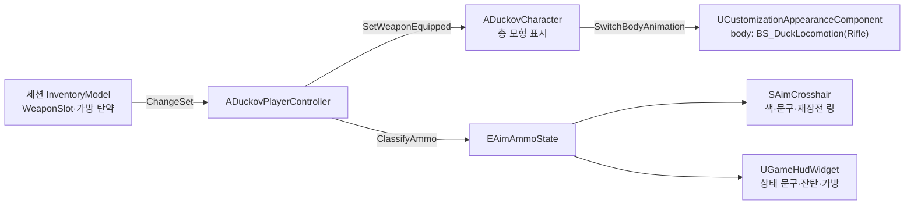

# 설계결정기록 039 — 총을 쥔 자세와 탄약 상태 표시: BlendSpace 교체, body bone 총 모형, 십자선 상태

| 항목 | 내용 |
| --- | --- |
| 상태 | Accepted |
| 날짜 | 2026-11-17 |
| 작업 범위 | M3 / 기본 공격 후속 — 총을 쥔 애니메이션, 탄약 부족·재장전 표시 가시성 |
| Risk | LOW — 게임 모듈·애니메이션 에셋·HUD를 로컬에서 바꾼다. 저장 레코드 v1·InventoryCore·네트워크는 바꾸지 않는다. 공통 외형 컴포넌트에 API를 하나 더해 독립 검토를 둔다 |
| 판단 주체 | 목표는 사용자 지시("캐릭터의 총을 쥐었을 때의 애니메이션과 탄약 부족 및 재장전 ui 가시성을 높이자"). 자세 모양·총 모형·재생 구조·표시 방식·수치·테스트는 AI(위임 범위) |
| 사용자 검토 | 사용자 PIE에서 결함(미장착 총 표시) 보고 후 수정본 확인(2026-11-17, "확인했고"). 사용자 보고이며 AI 직접 관찰 아님 |
| 관련 | [034 플레이어 걷기 애니메이션](034-player-locomotion-animation.md)의 재검토 조건("사격·조준 등 상체 동작이 생길 때")에 답한다. [035 마우스 조준](035-mouse-aim-rotation.md)의 십자선, [038 기본 공격의 피해 경로](038-damage-path-and-training-dummy.md)의 A3·A4 탄창·재장전 계약은 유지한다 |

## Context / Decision Question

A3·A4로 총을 쏘고 재장전할 수 있게 됐지만, 총을 장착해도 캐릭터는 맨손 Idle·Walk 그대로였고 화면 어디에도 총이 보이지 않았다.
탄약 상태는 오른쪽 아래 20pt 글자("5 / 18", "재장전 중  5 / 18")와 아래 중앙 문구로만 알렸다. 조준 중 시선은 커서에 있으므로 탄창이 비거나 재장전 중인 것을 놓치기 쉬웠다.
body는 AnimBlueprint 없이 `UAnimSingleNodeInstance`로 BlendSpace 하나를 재생하고 부위는 leader pose로 따른다(034).

## Decision / Rationale

- **총을 쥔 동작은 같은 축의 BlendSpace 하나 더**: Blender 원본(`CharacterAnimation.blend`)에 `A_DuckIdleRifle`·`A_DuckWalkRifle`을 더했다.
  몸·머리·발은 기본 동작 함수를 그대로 쓰고, 늘어진 날개만 어깨에서 총 쪽 목표 점으로 돌린다(최소 회전, `hold_wings`). 그래서 길이·걸음이 같다.
  `BS_DuckLocomotionRifle`은 `CharacterAnimationAssets.Create`가 기본 BlendSpace와 같은 Speed 축·sample 배치로 만든다.
- **장착하면 재생 asset만 교체**: `UCustomizationAppearanceComponent::SwitchBodyAnimation()`이 표시 중인 body에 `PlayAnimation`만 다시 하고 BlendSpace 입력을 유지한다.
  body·부위·leader pose와 "검증 후 한 번에 공개" 계약은 건드리지 않는다. 바꾼 asset을 `BodyAnimation`에도 넣어 같은 Profile 재적용이 body를 다시 만들지 않는다.
- **총 모형은 body bone에 붙인 기본 도형 4개**: 개머리판·총몸·탄창·총열을 `/Engine/BasicShapes/Cube`로 만들고, 표시 중인 body의 `body` bone에 붙인다.
  조각 위치는 mesh 원점 기준 값이고 붙일 때 reference pose의 bone 변환을 되돌려(`GetComponentSpaceTransformRefPose`의 역) bone을 따라 숨쉬기·뒤뚱걸음과 함께 움직인다.
  위치는 Blender 미리보기의 `GUN_PARTS`를 UE 축으로 옮긴 값이라 날개 자세와 맞는다. 외형을 다시 적용할 때는 총을 기준점으로 옮겼다가 새 body에 붙인다(이전 body가 없어지기 때문).
- **장착 여부는 controller가 알린다**: 무기 slot은 세션 Model이 소유한다. controller가 BeginPlay·OnPossess·ChangeSet에서 `SetWeaponEquipped`를 부르고, 캐릭터는 표시 상태만 갖는다.
- **탄약 상태는 커서 자리의 십자선이 먼저 알린다**: `ClassifyAmmo`가 Ready / Low(탄창 4분의 1 이하) / Empty(탄창 0, 가방 탄약 있음) / NoAmmo / Reloading을 정한다.
  십자선은 Low면 주황, Empty·NoAmmo면 빨강 눈금과 아래 문구("R 재장전" / "탄약 없음"), Reloading이면 둘레에 위쪽부터 시계 방향으로 차는 링을 그린다.
  커서 위젯은 Slate가 매 frame 그리므로(`FSlateUser::DrawCursor`) 진행률은 그릴 때의 시각으로 계산한다. 상태가 바뀔 때만 controller가 값을 넣고 Tick은 없다.
- **오른쪽 아래 HUD는 같은 상태를 크게**: 어두운 판 위에 상태 문구, 30pt 잔탄, 16pt "/ 가방 탄약". 상태색은 십자선과 같고 가방 탄약이 0이면 빨강이다.

## Alternatives / Trade-offs

- **AnimBlueprint로 상체 레이어 블렌딩**(034의 재검토 조건이 예상한 길): 장착 전환을 부드럽게 섞고 반동·조준 상하 같은 동작을 얹기 좋다.
  하지만 graph를 스크립트로 만들고 검증하기 어렵고, 지금 바뀌는 것은 날개 두 개뿐이라 BlendSpace 교체로 충분하다. 대가로 장착·해제 순간 자세가 섞이지 않고 바로 바뀐다(대개 메뉴를 닫을 때라 눈에 띄지 않는다).
- **Speed×Armed 2D BlendSpace 하나**: 전환이 입력 smoothing으로 부드럽다. 기존 `BS_DuckLocomotion`과 입력 API(1축)를 바꿔야 해서 기존 테스트·계약을 건드리는 범위가 커 버렸다.
- **UE에서 기존 시퀀스를 복사해 날개 track만 덮어쓰기**: Blender와 pilot import가 필요 없다. 하지만 034의 "Blender 원본이 기준" 계약이 깨지고 미리보기로 자세를 확인할 수 없어 버렸다.
- **총 모형을 외형 기준점(VisualRoot)에 고정**: 붙이기가 단순하다. 몸이 숨쉬고 뒤뚱거리는 동안 날개(body를 따름)와 총이 어긋나 버렸다.
- **재장전 진행을 HUD ProgressBar와 timer로 갱신**: 익숙한 UMG 방식이지만 재장전 동안 주기 갱신이 필요하고 시선에서 멀다. 커서는 어차피 매 frame 그려진다.

## Consequences / Accepted Costs

- 총 모형은 기본 도형 조합이라 실제 총 아트가 아니다. 무기 종류가 하나(Rifle)라 모형도 하나다.
- 장착·해제 때 자세가 즉시 바뀐다(블렌드 없음). 사격 반동·재장전 동작 애니메이션은 없다. 재장전은 십자선 링과 HUD 문구로만 보인다.
- 날개 목표 점은 Round 날개 mesh 기준이다. 다른 날개 유형(Mitten·Small)도 같은 bone 회전을 쓰므로 총에 닿는 정도가 조금 다르다.
- 십자선 위젯이 문구를 담으려고 140×100 px가 됐다. 위젯 가운데가 커서라 조준 지점은 그대로다.
- `SAimCrosshair`의 재장전 시작 시각은 Slate 시각이고 재장전 timer는 world 시각이다. 시간 배율을 바꾸지 않는 지금은 같다.
- `UCustomizationAppearanceComponent`에 `SwitchBodyAnimation`·`GetBodyAnimation`이 생겼다. 애니메이션 없는 body(커스터마이징 미리보기)에는 재생을 바꾸지 않고 다음 TryApply에 맡긴다.

## Revisit Conditions

- 사격 반동·재장전 동작·조준 상하처럼 상체에 얹는 동작이 필요할 때: AnimBlueprint 레이어 블렌딩으로 옮긴다.
- 무기 종류가 늘 때: 총 모형과 자세를 무기 Definition 데이터로 옮긴다.
- 시간 배율(slow motion·일시정지 중 재장전)을 넣을 때: 링 진행을 world 시각 기준으로 바꾼다.

## Verification

2026-11-17 실행 결과. 증거는 `Saved/Automation/RifleHold/`와 `Saved/Automation/CharacterAnimation/`에 있다.

- Blender `author_animation.py add-rifle`·`export-animations`: 4개 action의 루프 이음매(위치 1e-15 cm, 회전 0)·지면 관통 없음·FBX 왕복 bone 오차 2e-5 cm PASS.
  미리보기 render로 날개 자세와 총 위치를 두 번 고쳤다(첫 render는 총 조각 scale 계산 실수로 1 cm 크기, 둘째는 날개가 총보다 높음).
- 일회용 pilot UE `import_animation.py animations`: 4개 첫 frame 방향 검사 PASS(`import-animation-rifle-report.json`, `PilotImportRifle.log`). 새 AnimSequence 2개만 Content로 옮겼다.
- `CharacterAnimationAssets.Create`: `BS_DuckLocomotionRifle` 생성(기존 `BS_DuckLocomotion`은 덮어쓰지 않음).
- 빌드: 첫 빌드가 C4458(`ACharacter::Mesh`를 가린 지역 변수)로 실패해 이름을 바꿨고, Editor·Game `Result: Succeeded`.
- 대상 테스트(실제 D3D12 RHI): `CharacterAnimationAssets.Verify`(총 쥔 동작은 날개만 45° 넘게 다르고 다른 bone은 같음), `Duckov.Combat.*`(새 `AmmoState`·`AimCrosshairPaint`,
  `RifleInput`의 총 모형·동작 전환, `Reload`의 HUD 문구·십자선 상태), `Duckov.Basement.CharacterMovement`, `Duckov.Customization.Skeletal.*` 통과.
- 화면 증거: 십자선 상태별 그림(`Crosshair_*.png`)에서 색·한글 문구·반쯤 찬 링을, PIE 화면(`RifleInput_Holding.png`)에서 가슴 앞 총과 "탄약 없음 0 / 0" HUD를 AI가 확인했다.
  PIE 화면 캡처에는 커서 위젯이 들어가지 않는다. Computer Use는 게임 창을 앱으로 찾지 못해 실제 입력 조작은 not_run이다.
- 전체 회귀(A1과 같은 필터, 실제 D3D12 RHI, `-nocefaccelpaint`): **143개 / 실패 0**(141 succeeded + 2 succeededWithWarnings, 기존 종류 경고, `RunFull1.log`) = 141개 + 새 2개.
- 독립 검토(cpp-reviewer, fresh context): **PASS**, LOW 2·INFO 3. 장착 전환 때 걸음 위치가 0으로 돌아가는 것은 재생 위치를 이어 가도록 고쳤고(BlendSpace 입력 smoothing이 다시 시작되는 것은 비용으로 남김),
  링 테스트는 그리는 시계(FApp)의 진행률로 기대값을 정하게 고쳤으며, 동작 전환 실패를 로그로 남겼다. 맵을 떠난 뒤 이전 십자선 상태가 잠깐 그려질 수 있는 점과 HUD 헤더 include는 그대로 두었다.
  반영 뒤 Editor·Game 빌드 `Result: Succeeded`, 전체 회귀 다시 **143개 / 실패 0**(`RunFull2.log`, 링 진행률 0.51 시점). 반영분 재검토는 not_run.
- 미검증: 사용자 PIE(자세·총 모형 크기, 십자선 링 체감), 패키징 실행.
- 사용자 PIE에서 발견한 결함(2026-11-17): 장착하지 않아도 총 조각이 body bone 위치에 보였다. 생성자에서 부모에 준 propagate 숨김이 등록 전이라 조각에 닿지 않았다.
  조각마다 숨기고 PIE 테스트가 조각 가시성을 보도록 고쳤다. 같은 결함을 막는 규칙: 생성자에서 자식 component의 상태는 부모 propagate가 아니라 자식에 직접 설정한다.

