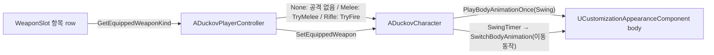

# 설계결정기록 040 — 근접 무기: 무기 slot 공유, 날개 bone 방망이, 한 번 재생하는 휘두르기

| 항목 | 내용 |
| --- | --- |
| 상태 | Accepted |
| 날짜 | 2026-11-17 |
| 작업 범위 | M3 / 기본 공격 후속 — 근접 무기를 장착했을 때만 근접 공격, 휘두르기 애니메이션 |
| Risk | LOW — 정의 DataTable에 행 하나, 세션 시작 인벤토리에 항목 하나를 더하고 게임 모듈의 공격 분기를 바꾼다. 저장 레코드 v1·InventoryCore API는 바꾸지 않는다 |
| 판단 주체 | 사용자: "근접 공격은 근접 무기를 장착했을 때 만 가능하게 하고 근접무기를 휘두르는 애니메이션을 추가하자", 장착 위치는 "기존 무기 slot 공유"(선택지 중 선택). 무기 종류 구분·모형·동작·재생 구조·테스트는 AI(위임 범위) |
| 사용자 검토 | 사용자 PIE 확인(2026-11-17, "잘 작동해"). 사용자 보고이며 AI 직접 관찰 아님 |
| 관련 | [038 기본 공격의 피해 경로](038-damage-path-and-training-dummy.md)의 A2 "맨손 근접 공격"을 바꾼다(판정·피해·간격은 그대로, 맨손 공격만 없앰). [032 무기·방어구 slot](032-weapon-armor-equipment-slots.md)의 무기 slot 하나를 그대로 쓴다. [039 총을 쥔 자세](039-rifle-hold-and-ammo-visibility.md)의 bone 부착·동작 교체 방식을 따른다 |

## Context / Decision Question

A2부터 무기 slot이 비어 있으면 LMB가 맨손 근접 공격이었다. 사용자는 근접 공격을 근접 무기를 들었을 때만 하고, 휘두르는 동작을 보이길 원했다.
무기 slot은 2×1 하나이고 무기 정의는 Rifle뿐이었다. body는 AnimBlueprint 없이 single node로 BlendSpace 하나를 재생한다(034, 039).

## Decision / Rationale

- **방망이 정의와 시작 위치**: 정의 DataTable에 `Bat`(2×1, non-stackable, `Weapon`)을 더한다(`InventoryWeaponAssets.AddMeleeDefinition`, 다시 실행해도 같음).
  세션은 방망이(id 7)를 창고 (4,3)에 두고 시작한다. 맨 아래 줄 오른쪽이라 앞줄의 빈칸과 first-fit 보관 순서가 그대로다. `NextInstanceId`는 8이 된다.
- **무기 slot 공유(사용자 선택)**: 총이나 방망이 중 하나만 장착한다. controller의 `GetEquippedWeaponKind()`가 slot 항목의 정의 row 이름으로
  `None`·`Rifle`·`Melee`를 정한다. LMB는 None이면 아무것도 하지 않고, Melee면 `TryMelee`, Rifle이면 사격이다. 재장전·탄약 HUD·십자선 탄약 상태는 Rifle일 때만이다.
- **방망이 모형은 오른날개 bone에**: 기본 Cylinder 두 개(손잡이·몸통, 갈색)를 `wing_r`에 붙인다(039와 같은 reference pose 역변환).
  날개 끝에서 앞 아래로 뻗어 기본 Idle·Walk의 날개 흔들림을 그대로 따른다. 그래서 근접 무기 전용 이동 동작은 만들지 않았다.
- **휘두르기는 한 번 재생하고 되돌린다**: Blender `add-swing`으로 `A_DuckMeleeSwing`(10 frame, 0.33초)을 만든다. 몸을 비틀며 오른날개를 뒤 위에서 앞으로 내려치고, rest에서 시작해 rest로 끝난다.
  `TryMelee`가 성공하면 `UCustomizationAppearanceComponent::PlayBodyAnimationOnce`로 body에서 한 번 재생하고, 그 길이 뒤 timer가 장착 무기의 이동 동작으로 되돌린다(`SwitchBodyAnimation`).
  판정·피해는 누른 순간 그대로 처리하고(A2와 같음), 휘두르는 중 무기가 바뀌면 timer를 지우고 새 무기의 동작으로 바로 바꾼다.

## Alternatives / Trade-offs

- **근접 전용 slot과 전환 키**(원작 구성): 총과 방망이를 함께 들 수 있다. 장비 slot·화면 칸·전환 입력과 상태가 늘어 범위가 커서 사용자가 공유를 골랐다.
- **정의 row에 무기 종류 필드 추가**: 데이터로 구분해 무기가 늘어도 코드가 안 바뀐다. InventoryCore의 Public 정의 struct와 DataTable 에셋을 바꿔야 하는데 무기가 둘뿐이라 row 이름 구분으로 충분하다.
- **AnimBlueprint slot/montage로 상체만 휘두르기**: 걸으면서 휘두를 수 있다. 034·039와 같은 이유(graph를 스크립트로 만들고 검증하기 어려움)로 미뤘다.
  대가로 휘두르는 0.33초 동안 몸 전체가 휘두르기 동작이라 걸으면 발이 미끄러진다.
- **휘두르기 끝에 판정**: 내려치는 순간과 맞는 순간이 맞지만 입력 지연이 생기고 A2 판정·테스트 계약이 바뀐다. 누른 순간 판정을 유지했다.

## Consequences / Accepted Costs

- 맨손으로는 공격할 수 없다. 시작 상태는 맨손이라 공격하려면 인벤토리에서 방망이나 소총을 장착해야 한다.
- 무기 종류가 row 이름("Bat")에 묶였다. 근접 무기가 늘면 정의 데이터에 종류 필드를 둔다.
- 휘두르는 동안 body가 이동 BlendSpace를 재생하지 않는다(발 미끄러짐). 이 사이에 외형을 다시 적용하면 body를 새로 준비하며 이동 동작으로 돌아간다.
- A2의 발밑 판정 원(0.12초)은 그대로 둔다. 휘두르기와 함께 판정 범위를 보여 준다.
- 이전의 `InventoryEquipmentAssets.AddDefinitions`는 행 수 검사 때문에 지금 DT에서 저장 없이 실패하는 일회성 명령이 됐다(032의 가방 명령과 같은 처지).
- 날개 bone은 mesh import의 reference pose와 애니메이션 import의 회전 비교에 쓰지 않고 Idle 첫 frame(원본 key)과 비교한다. 방금 옮긴 에셋의 압축 데이터로 읽으면 엉뚱한 값이 나왔다.

## Revisit Conditions

- 걸으면서 휘두르기·연속 공격·공격 방향 변화가 필요할 때: AnimBlueprint 상체 레이어와 montage로 옮긴다.
- 근접 무기가 둘 이상이 되거나 무기별 피해·간격이 달라질 때: 정의 데이터에 무기 종류·수치를 둔다.
- 총과 근접 무기를 함께 들어야 할 때: 근접 전용 slot과 전환 입력을 별도 결정한다.

## Verification

2026-11-17 실행 결과. 증거는 `Saved/Automation/Melee/`, `Saved/Automation/CharacterAnimation/`, `Saved/Automation/RifleHold/MeleeInput_Swing.png`에 있다.

- Blender `add-swing`·`export-animations`: 루프 검사(처음=끝, 위치 5e-16 cm, 회전 0)·지면 관통 없음·FBX 왕복 bone 오차 1.8e-5 cm PASS. 미리보기 render로 내려치기 궤적을 확인했다.
  FBX를 Blender로 다시 읽어 휘두르기 0 frame의 날개 회전이 Idle 0 frame과 같음(0°)을 따로 확인했다.
- 일회용 pilot UE import PASS(`PilotImportSwing.log`). 새 `A_DuckMeleeSwing`만 Content로 옮겼다. `InventoryWeaponAssets.AddMeleeDefinition` 실행으로 DT에 `Bat` 행 추가(원본 DT는 scratchpad에 백업).
- 실패 기록: 첫 대상 실행에서 세션 시작 인벤토리 `Load`가 `InvalidCounter`로 실패했다(방망이 id 7 = `NextInstanceId` 7). 그 상태에서 PIE 테스트가 null Model에 `TryMove`를 불러 에디터가 종료됐다.
  카운터를 8로 올리고 테스트에 null 확인을 넣었다. `CharacterAnimationAssets.Verify`는 휘두르기 처음·끝 날개가 145°로 읽혀 실패했다. pilot UE에서 직접 평가하면 0°라 테스트가 압축 데이터를 읽은 것이 원인이었고, 원본 key로 비교하게 고쳤다.
- 대상 테스트(실제 D3D12 RHI): `InventoryAssets.Verify`, `CharacterAnimationAssets.Verify`, `Duckov.Combat.*`(맨손 LMB 공격 없음, 방망이 장착·휘두르기 재생·과녁 피해·이동 동작 복귀, 소총 해제 뒤 공격 없음), `Duckov.Basement.*`, `Duckov.Raid.*` 15개 통과(`Targeted3`).
- 전체 회귀(A1과 같은 필터, 실제 D3D12 RHI, `-nocefaccelpaint`): **143개 / 실패 0**(141 succeeded + 2 succeededWithWarnings, 기존 종류 경고, `RunFull1.log`). 새 테스트 없이 기존 테스트를 넓혔다.
- 독립 검토(cpp-reviewer, fresh context): **PASS**, LOW 1·INFO 5. 휘두른 뒤 이동 동작을 처음부터 재생(휘두르기 시간이 BlendSpace 정규화 위치로 이어지던 것), 맨손 Attack 같은 frame 검사,
  휘두르기 검증의 Idle null 확인을 반영했다. 휘두르는 중 외형 재적용의 body 재생성(LOW)은 지금 닿지 않는 경로라 위 비용과 주석으로 남겼다. 반영 뒤 Editor·Game 빌드 Succeeded, 전체 회귀 다시 **143개 / 실패 0**(140 + 기존 종류 경고 3, `RunFull2.log`). 반영분 재검토는 not_run.
- 미검증: 패키징 실행. 사용자 PIE는 확인됐다(위 표).

